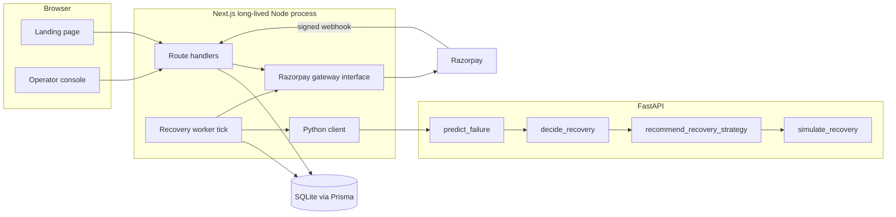
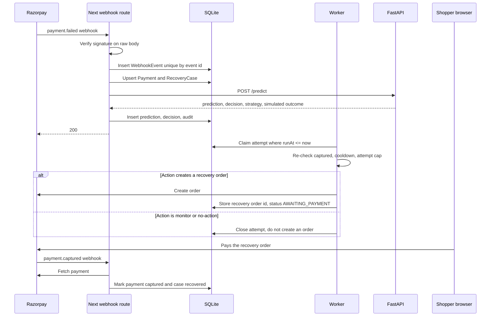

# RecoverAI Implementation Specification

| Field | Value |
| --- | --- |
| Document | `RECOVERAI_IMPLEMENTATION_SPEC.md` |
| Version | 1.0 |
| Date | 2026-10-30 |
| Status | Approved for phased execution only after the user names a phase |
| Baseline | Repository as reviewed on 2026-10-30. Next.js 14.2.3, React 18, Tailwind 3.4, `razorpay` 2.9.8, FastAPI bridge in `ml/api.py`, scikit-learn model artifact `ml/models/recoverai_failure_model.joblib` |
| Execution rule | Implement exactly one phase per session. Stop and request approval before the next phase |

This document is the engineering source of truth for future implementation. It describes the current code, the target system, and six independently testable phases. It does not claim that the existing model or the current revenue figures are production-validated.

## How to read this document

- **Existing** means the behavior is in the repository today.
- **Target** means behavior that does not exist yet and must be built in the phase named beside it.
- If this document and the code disagree about what exists today, the code wins for “what is”, and this document wins for “what to build”. Reconcile the difference in the phase report. Do not silently invent a third design.
- Financial words are reserved. **Verified recovered revenue** means the sum of Razorpay payments whose status was confirmed as `captured` after signature verification and a server-side payment fetch. **Simulated recovered revenue** means an outcome from `ml/src/simulate_recovery.py` or the in-memory timer. These numbers must never share a label, a database column, or a dashboard total.
- **Phase 2 repair addendum** — If Phase 2 was marked verified before pre-commit repairs landed, read [Phase 2 Repair Addendum — Pre-Commit Fixes](#phase-2-repair-addendum--pre-commit-fixes). That section is mandatory before the first Phase 2 commit. It does not start Phase 3.

## Assumptions

These are explicit. Do not treat them as discovered facts.

1. The app is run as a long-lived Node process (`next dev` or `next start`), not as a short-lived serverless function. A timer inside that process is acceptable for the student deployment. A future hosted deploy may extract the same tick function into a separate process without changing its logic.
2. Currency is INR only. Amounts in the database are integer paise. Rupees appear only at the UI boundary and in the ML feature payload, where the existing model expects rupees.
3. Razorpay is used in test mode until the operator supplies live keys. This spec does not enable live charges.
4. A failed one-time Checkout payment cannot be silently captured again. Recovery execution creates a new order or payment link, or records that a retry is not allowed. A case becomes recovered only after a later payment is verified captured. No code path may set “recovered” because a timer elapsed.
5. One developer can run SQLite locally. The schema is written so PostgreSQL can replace SQLite later by changing the Prisma datasource. Do not add PostgreSQL, Redis, Kafka, or a second deployable service in phases 1–6.
6. Authentication is introduced in Phase 4. Phases 1–3 keep the current public demo surface and add server-to-server secrets only where webhooks and the worker need them.
7. Email, SMS, and WhatsApp delivery are out of scope until Phase 6, and even then they are an interface, not a requirement to pick a paid vendor. The in-app case record is the system of record.
8. The held-out synthetic metrics in `ml/models/model_metadata.json` are historical measurements of the current artifact: ROC AUC 0.7897, average precision 0.5592, Brier 0.1163, best test F1 0.5256 at threshold 0.25, 50,000 training rows, target `payment_failed`, model `GradientBoostingClassifier`. They are not production performance.

## Non-goals

- Replacing Next.js, React, Tailwind, the Razorpay Node SDK, or FastAPI.
- Rewriting the ML training scripts in Phase 1.
- Deleting `ml/src/diag.py`, `diag2.py`, `diag3.py`, notebooks, or the landing page.
- Storing card numbers, CVV, UPI PIN, or raw magnetic-stripe data.
- Claiming production certification, PCI level, or a live recovery rate.

---

# SECTION 1 – Project Overview

## 1.1 Product vision

RecoverAI helps a merchant recover failed payments by deciding whether a failure is worth a retry, which action is allowed, and whether a later payment actually captured. The model proposes a failure probability. A deterministic policy chooses an action. Guardrails can block that action. Razorpay confirms money movement. The product shows those steps separately so an operator can audit them.

The vision sentence to preserve in the product:

> AI proposes. Rules control. Only a verified capture counts as recovered revenue.

## 1.2 Problem statement

Payment failures drop revenue. Retrying every failure wastes attempts, can violate gateway limits, and can charge the wrong case. The current RecoverAI demo illustrates a pipeline, then marks every case recovered when a shortened timer ends. Seeded totals start at ₹700,000 and 280 transactions (`lib/engines/simulation-service.ts`). A merchant cannot tell a real capture from a simulation.

The product must answer four questions with stored evidence:

1. Which payment failed, and what reason did Razorpay return?
2. What failure probability, recovery probability, and action did the system compute?
3. Which guardrail allowed or blocked execution?
4. Did a later Razorpay payment reach `captured`?

## 1.3 Target users

| User | Need | Phase available |
| --- | --- | --- |
| Merchant owner | See verified revenue, set retry policy, invite operators | Phase 4 auth, Phase 6 policy depth |
| Recovery operator | Work a queue of open cases, read the decision, record an outcome | Phase 4 |
| Reviewer / viewer | Read cases and audit logs, cannot change policy or execute retries | Phase 4 |
| Student / developer | Run the stack locally, inspect decisions, compare the model with a baseline | Phase 1 onward |
| Demo visitor | Use the landing page and Razorpay test checkout without an account | Existing, corrected in Phase 1 |

There is no consumer wallet user. The shopper interacts only with Razorpay Checkout or a recovery payment link.

## 1.4 Core capabilities

| Capability | Existing today | Target |
| --- | --- | --- |
| Marketing landing page | Yes, `app/page.tsx` | Keep. Relabel metrics in Phase 1. Restyle with the app in Phase 4 |
| Razorpay test order | Yes, `POST /api/payment/create-order` | Keep. Add idempotency and paise consistency in Phase 2 |
| Signature verification | Yes, `POST /api/payment/verify` | Keep. Fix length mismatch. Also fetch payment status |
| Browser failure bridge | Yes, `POST /api/recovery/trigger` | Keep as a client hint. Webhook becomes the durable source in Phase 2 |
| Failure probability model | Yes, synthetic gradient boosting | Keep the artifact. Do not call it production-validated. Improve in Phase 5 |
| Decision and strategy | Yes, Python rules plus a second TypeScript rule engine | Python becomes the only action chooser in Phase 3 |
| Execution | Timer that always succeeds | Persist attempts. Success only from verified capture |
| Case queue, audit, settings | Not built | Phase 4 |
| Learning from verified outcomes | Not built | Phase 5 |

## 1.5 Expected final product

After Phase 6, a developer can:

1. Start Next.js, the FastAPI process, and the database.
2. Sign in as a seeded merchant user.
3. Cause a Razorpay test failure, or receive a signed test webhook.
4. See one recovery case whose failure reason, probabilities, action, guardrail result, and attempts are stored.
5. Observe a scheduled retry that does not depend on the browser staying open.
6. See verified recovered revenue move only when a payment is captured.
7. See simulated outcomes in a separate, labeled area.
8. Read an audit trail of who or what changed the case.
9. Compare the model’s recommended actions with a retry-everything baseline on the same stored cases.
10. Configure retry limits and cooldowns without editing Python.

The landing page still demonstrates the pipeline. Its numbers are labeled illustrative or simulated.

## 1.6 Functional requirements

| ID | Requirement | Phase |
| --- | --- | --- |
| FR-1 | The landing timeline shows the Razorpay error description for a real failure, not a hardcoded “timeout” sentence | 1 |
| FR-2 | Failure probability, recovery probability, and decision confidence are three different fields | 1 |
| FR-3 | Python strategy names are shown as returned. They are not collapsed into `DELAYED_RETRY` | 1 |
| FR-4 | A simulated `not_recovered` or `no_action` result does not increment recovered revenue or transactions saved | 1 |
| FR-5 | The seeded ₹7L figure is labeled illustrative, or removed from any “live” total | 1 |
| FR-6 | Orders, payments, failures, cases, predictions, decisions, attempts, webhooks, and audit rows persist in SQLite | 2 |
| FR-7 | Razorpay webhooks are verified and idempotent. A duplicate event does not create a second case | 2 |
| FR-8 | Closing the browser does not delete the case or cancel a due attempt | 2 |
| FR-9 | Payment status is read from the Razorpay API before any success is stored | 2 |
| FR-10 | Only the Python decision module chooses `NO_ACTION`, `MONITOR`, `SMART_RETRY`, `ALTERNATIVE_PAYMENT_METHOD`, or `PRIORITY_RECOVERY` | 3 |
| FR-11 | Retry count, cooldown, duplicate execution, and already-captured checks can block an action | 3 |
| FR-12 | Every decision stores the rule identifiers that fired | 3 |
| FR-13 | An operator can list, filter, and open cases | 4 |
| FR-14 | Roles owner, operator, and viewer are enforced on write APIs | 4 |
| FR-15 | Analytics separate verified captures from simulated outcomes | 4 |
| FR-16 | The model consumes a normalized failure-reason code | 5 |
| FR-17 | Held-out evaluation reports the model against a retry-everything baseline | 5 |
| FR-18 | Verified attempt outcomes are stored as future training rows | 5 |
| FR-19 | Merchant policy edits change guardrail inputs without a code change | 6 |
| FR-20 | High-value cases can require human approval before a recovery order is created | 6 |

## 1.7 Non-functional requirements

| ID | Requirement | Measure |
| --- | --- | --- |
| NFR-1 | A decision for one payment finishes without a browser round trip after the webhook is stored | Worker picks up a due attempt within 15 seconds on a local machine |
| NFR-2 | Webhook handler responds in under 2 seconds and does the slow work after the event row is committed | Handler writes the event, enqueues work, returns 200 |
| NFR-3 | Secrets never appear in client bundles | `RAZORPAY_KEY_SECRET` and `WEBHOOK_SECRET` have no `NEXT_PUBLIC_` prefix. A bundle grep test fails the build if they do |
| NFR-4 | Repeated submission of the same webhook id is safe | Second insert conflicts; response is 200 with `duplicate: true`; one case exists |
| NFR-5 | Logs do not contain secrets, signatures, or full payment payloads | Audit stores ids, amounts in paise, reason codes, and action names |
| NFR-6 | The landing demo still runs if FastAPI is stopped | Checkout shows the existing unavailable message. Mock timeline keeps running and is labeled simulated |
| NFR-7 | Phase tests pass without live Razorpay keys | Razorpay client is behind an interface with a fake in tests |
| NFR-8 | Student machine can reset state | `npx prisma migrate reset` plus the seed script restores one merchant |

---

# SECTION 2 – Existing Architecture Assessment

This section records the 2026-10-30 review. Do not “fix” these facts by deleting the description. Implement the changes in the phase that owns them.

## 2.1 Existing frontend architecture

Single App Router page. There is no `app/(auth)`, no dashboard route, and no case route.

| Piece | File | Behavior |
| --- | --- | --- |
| Root layout | `app/layout.tsx` | Inter font, Razorpay `checkout.js` via `next/script` strategy `lazyOnload`, wraps children in `SimulationProvider` |
| Page | `app/page.tsx` | Composes Navigation, Hero, Problem, Solution, Mixed, Experience, Footer |
| State | `context/SimulationContext.tsx` | Polls `GET /api/monitoring` every 2500 ms. Falls back to hardcoded metrics if the request fails |
| Timeline | `components/LiveRecoveryPath.tsx` | Five steps. Steps 2–4 repeat the same decision card. Step 1 meta text is fixed: “Payment gateway rejected attempt due to timeout.” Step 5 title is always “Payment Recovered” |
| Checkout | `components/CheckoutButton.tsx` | Fixed ₹499. Creates an order, opens Checkout, verifies success, posts failures to `/api/recovery/trigger`. `retry.enabled` is false |
| Metrics | `components/RevenueRecovered.tsx`, `components/SolutionSection.tsx` | Render context totals and risk. Solution copy says the system “automatically activates the appropriate recovery path” |
| Styling | `tailwind.config.ts`, `app/globals.css` | Deep navy, ice blue, coral, amber. Dark marketing site, not an operations console |

`LiveRecoveryPath` builds icon color classes as `` `text-${step.color}` ``. Tailwind’s content scanner does not see those dynamic strings, so those utilities are not generated unless they appear elsewhere as complete class names.

Navigation “Start Recovery” links to `#hero`, not to checkout. Checkout sits at the bottom of the experience section.

## 2.2 Existing backend architecture

Next.js route handlers only. No database client, no middleware, no auth, no job runner.

| Route | File | Behavior |
| --- | --- | --- |
| `GET /api/monitoring` | `app/api/monitoring/route.ts` | Calls `simulationService.tick()` and returns the in-memory state. `dynamic = 'force-dynamic'` |
| `POST /api/payment/create-order` | `app/api/payment/create-order/route.ts` | Validates a positive INR number, converts to paise with `Math.round`, creates a Razorpay order. Secret stays server-side |
| `POST /api/payment/verify` | `app/api/payment/verify/route.ts` | HMAC-SHA256 of `order_id\|payment_id` compared with `crypto.timingSafeEqual` |
| `POST /api/recovery/trigger` | `app/api/recovery/trigger/route.ts` | Builds an ML payload, calls `${FASTAPI_URL}/predict` (default `http://localhost:8000`), maps the result into `RecoveryDecision`, calls `simulationService.injectRealEvent` |

Process state lives in `lib/engines/simulation-service.ts`. The singleton is stored on `globalThis` only when `NODE_ENV !== 'production'`. In production each module instance has its own state.

`tick()` returns immediately if the last tick was under 2 seconds ago. Metrics are random. About 30% of ticks start a degraded gateway, and any active recovery with `step < 5` forces degraded metrics. High TypeScript risk creates a mock failure for a random amount between ₹3,000 and ₹25,000.

## 2.3 Existing Razorpay integration

Implemented:

- Server order creation with `receipt: rcpt_${Date.now()}`.
- Client Checkout for ₹499.
- Success path posts `razorpay_order_id`, `razorpay_payment_id`, and `razorpay_signature` to `/api/payment/verify`.
- Failure path reads `payment.failed`, closes the modal, and posts the error to `/api/recovery/trigger`.

Not implemented:

- Webhooks.
- Server-side `payments.fetch`.
- Payment links or a second recovery order.
- Subscription objects.
- Persistence of the order id before Checkout opens. If the Node process restarts, the order exists only at Razorpay.

`ondismiss` sets status `cancelled` with no guard. A failure and a dismiss can both run.

## 2.4 Existing Python ML pipeline

`ml/api.py` exposes `GET /health` and `POST /predict`. The body is `TransactionInput` (12 model features plus `payment_id`). `run_recoverai_pipeline` in `ml/src/recoverai_pipeline.py` calls, in order:

1. `predict_failure` — loads `ml/models/recoverai_failure_model.joblib`, returns `failure_probability` and `risk_level` (`low` < 0.25, `medium` < 0.60, else `high`).
2. `decide_recovery` — `revenue_at_risk = amount * failure_probability`. Bands: `< 0.25 NO_ACTION`, `< 0.60 MONITOR`, `< 0.85 RECOVERY_ATTEMPT`, else `PRIORITY_RECOVERY`. If probability is at least 0.25 and revenue at risk is at least ₹5,000, the decision moves up one band. `NO_ACTION` is not raised because of amount alone.
3. `recommend_recovery_strategy` — maps the decision and `retry_count` to `NO_RECOVERY`, `MONITOR`, `SMART_RETRY` (30, 120, or 360 minutes), `ALTERNATIVE_PAYMENT_METHOD`, or `PRIORITY_RECOVERY` (15 minutes, or 60 minutes with an alternate method after two retries). `max_attempts_remaining = max(0, 3 - retry_count)`.
4. `simulate_recovery` — if the decision is `NO_ACTION` or `MONITOR`, outcome is `no_action`. Otherwise a hand-written probability is compared with an MD5/LCG draw from `payment_id`. The function’s own docstring says the output is a synthetic simulation.

`ml/src/generate_dataset.py` builds 10,000 synthetic customers and 50,000 attempts. `payment_failed` is a binomial draw from a sigmoid of the same features the model later receives. `historical_success_rate` is exactly `(previous_payment_count - previous_failure_count) / previous_payment_count`. There is no `requirements.txt`. Scratch scripts `ml/src/diag.py`, `diag2.py`, and `diag3.py` are not part of the API.

The dataset does not contain Razorpay error codes. The live trigger route does not send `errorCode` or `errorReason` into the model.

## 2.5 Existing decision-making flow

Two choosers run.

**Chooser A, TypeScript, drives the polling UI.** `calculateRiskScore` weights latency 35, success rate 30, error rate 20, timeout rate 15. `getRiskLevel` returns `LOW` below 30, `MEDIUM` below 60, else `HIGH`. `makeRecoveryDecision` maps that to `NO_ACTION`, `SCHEDULED_RECOVERY_WINDOW`, `RETRY_ALTERNATE_PROVIDER`, `FALLBACK_PAYMENT_ROUTE`, or `DELAYED_RETRY`, with fixed confidence numbers 0.98, 0.92, 0.89, 0.87, 0.85, and 0.80. `SolutionSection` uses different display cutoffs (35 and 60) than `getRiskLevel` (30 and 60).

**Chooser B, Python, runs only after a browser failure.** `buildRecoveryDecision` then flattens strategies:

| Python strategy or decision | Mapped `recommendedAction` |
| --- | --- |
| `NO_ACTION` | `NO_ACTION` |
| `MONITOR`, `RECOVERY_ATTEMPT`, `SMART_RETRY` | `DELAYED_RETRY` |
| `PRIORITY_RECOVERY` | `RETRY_ALTERNATE_PROVIDER` |
| `ALTERNATIVE_PAYMENT_METHOD` | `FALLBACK_PAYMENT_ROUTE` |
| `PRIORITY_RECOVERY_STRATEGY` | `SCHEDULED_RECOVERY_WINDOW` |

`PRIORITY_RECOVERY_STRATEGY` is not a value the Python strategy function returns. `NO_RECOVERY` is not in the map, so the code falls through to `decision.decision`.

`retry_count` sent to FastAPI is hard-coded to 0. Customer history comes only from `getDemoCustomer('demo_customer_001')`, which returns nine successes and one failure, subscription `active`, tenure 180 days. Any other customer id returns null and the route responds 500.

`RecoveryDecision.confidence` is set to `prediction.failure_probability`. The UI labels it “AI confidence”.

While `realEventActive` is true, the mock outage generator does not replace `latestDecision` or start another mock failure. It still randomizes provider metrics, including forcing them degraded because `step < 5`.

## 2.6 Existing simulation mechanism

`executeRecoveryAction`:

- `NO_ACTION` or a missing decision becomes `executionStatus: SUCCESS` and `step: 5` immediately.
- Any other action waits `min(retryDelayMs, 8000)`, then 2000 ms of “executing”, then always `SUCCESS` and `step: 5`.

`processRecoveryEngine` advances steps 1→2→3→4 on successive ticks, then calls the executor. On step 5 it adds `amount` to `revenueRecovered` and 1 to `transactionsSaved`, including the `NO_ACTION` path and including cases whose Python outcome was `not_recovered`. The Python `outcome` object is returned to the browser and then discarded.

Initial in-memory state is internally inconsistent: risk is low and `latestDecision` is `NO_ACTION`, while `activeRecovery` is already step 5 with a high-latency decision, id 9281, amount ₹12,450.

## 2.7 Working features

- Landing page layout and motion.
- Polling loop and visible step progression.
- Razorpay test order creation when `RAZORPAY_KEY_ID` and `RAZORPAY_KEY_SECRET` are set.
- HMAC verification when the signature hex length matches the digest.
- FastAPI prediction when the process is running and the model file loads.
- Feature construction from the single demo customer in `lib/ml/build-transaction-features.ts`.
- Offline training, comparison, and batch evaluation scripts under `ml/src/`.
- Clear comments in the trigger route that the simulated outcome is not a Razorpay capture.

## 2.8 Partially implemented features

- Guardrails described in `README.md` (limits, cooldown, idempotency, skip captured payments, late success). The strategy module computes `max_attempts_remaining` and does not enforce it against stored attempts.
- “End-to-end recovery”. The browser can inject one event. Nothing retries at the recommended delay, and nothing checks Razorpay afterward.
- Operator dashboard named in the README (command center, case list, batch evaluation UI, audit). The UI for those screens does not exist.
- Production singleton. The `globalThis` cache is disabled in production, so state does not survive duplicate module instances.

## 2.9 Missing features

- Database, ORM, migrations, seed.
- `.env.example` and `ml/requirements.txt`.
- Tests of any kind.
- Webhooks, worker, idempotency keys.
- Authentication and authorization.
- Merchant, customer, case, and policy records.
- Server-side payment fetch.
- A second recovery order or payment link.
- Failure-reason features, calibration, and a stored baseline comparison in the product.
- Feedback rows that could retrain the model.
- Rate limiting and request validation shared across routes.

## 2.10 Critical bugs

| ID | Bug | Evidence | Phase |
| --- | --- | --- | --- |
| BUG-1 | Every finished case increments recovered revenue | `simulation-service.ts` adds `updatedRecovery.amount` whenever `step === 5` | 1 |
| BUG-2 | Executor cannot fail | `recovery-execution-engine.ts` sets `SUCCESS` after the timer | 1 |
| BUG-3 | `NO_ACTION` is counted as a saved transaction | Executor short-circuits to step 5, then the tick accounts it | 1 |
| BUG-4 | Failure probability is labeled confidence | `buildRecoveryDecision` assigns `confidence: failure_probability` | 1 |
| BUG-5 | Strategy names are collapsed | `actionMap` in `app/api/recovery/trigger/route.ts` | 1 |
| BUG-6 | Timeline text ignores the real error | `LiveRecoveryPath` step 1 meta and step 5 title | 1 |
| BUG-7 | `timingSafeEqual` throws on unequal buffer lengths | `app/api/payment/verify/route.ts` | 1 |
| BUG-8 | Dynamic Tailwind classes | `text-${step.color}` in `LiveRecoveryPath.tsx` | 1 |
| BUG-9 | Dismiss and failure handlers can both run | `CheckoutButton` `ondismiss` | 1 |
| BUG-10 | Retry count is always zero, so strategy delay is always the first-retry branch | `derived.retry_count: 0` | 2 stores real counts; 3 uses them |
| BUG-11 | Signature match does not prove the payment is captured | verify route returns `verified: true` without `payments.fetch` | 2 |
| BUG-12 | In-memory state is the system of record | `simulation-service.ts` | 2 |

## 2.11 Technical debt

- Two action vocabularies (`RecoveryAction` in `lib/types.ts` versus Python strategy strings).
- Two risk scales (TypeScript 0–100 provider score versus Python 0–1 failure probability).
- ₹5,000 elevation threshold in `recovery_decision.py` and ₹500 “high exposure” note in `recovery_strategy.py`.
- Import-error stubs inside `simulate_recovery.py` use different probability cutoffs (0.50 and 0.75) than `decide_recovery` (0.60 and 0.85). Those stubs must not be used as a second policy.
- Demo customer is the only history source.
- No shared error body. Routes return slightly different `{ error: string }` shapes.
- README roadmap still lists Razorpay test mode as future work, while the routes exist.
- Public folder contains `public/untitled folder/` with a jpeg. Do not build a feature on it. Do not delete it in these phases unless the user asks.

---

# SECTION 3 – Target Architecture

## 3.1 Style

Keep one Next.js application and one FastAPI process. Add one SQLite database file. Do not add a message broker, an API gateway, or a third business service.



## 3.2 Component communication

| From | To | When | Contract |
| --- | --- | --- | --- |
| Browser Checkout | `POST /api/payment/create-order` | Shopper starts demo or recovery pay | JSON amount in rupees. Response includes order id and paise |
| Browser Checkout | Razorpay Checkout.js | Order exists | Existing client integration |
| Browser | `POST /api/payment/verify` | Checkout success handler | Existing signature fields |
| Browser | `POST /api/recovery/trigger` | Checkout failure handler | Existing failure body. After Phase 2 this is a hint. The webhook is authoritative if it arrives |
| Razorpay | `POST /api/webhooks/razorpay` | Payment or order event | Raw body plus `X-Razorpay-Signature` |
| Next route | Prisma | Every durable write | One transaction per state change |
| Worker | Prisma | Every 5 seconds | Claims due `RecoveryAttempt` rows with a lock |
| Worker or trigger route | `POST /predict` | A new failure needs a decision | Existing feature JSON plus the fields added in Phase 3 and Phase 5 |
| Worker | Razorpay orders API | Policy says create a recovery order and guardrails allow it | Creates an order. Does not mark the case recovered |
| Next verify or webhook | Razorpay payments API | A success is claimed | Fetch payment. Persist `captured` only if Razorpay says so |

FastAPI does not open the database and does not call Razorpay. Next.js does not choose the recovery action after Phase 3. Next.js may still compute gateway health numbers and pass them as features.

## 3.3 Frontend architecture

| Area | Routes | Phase |
| --- | --- | --- |
| Marketing | `/` stays `app/page.tsx` | 1 corrects copy and metrics. 4 applies the shared visual tokens |
| Auth | `/login`, `/logout` | 4 |
| App shell | `/app` | 4 |
| Dashboard | `/app` | 4 |
| Queue | `/app/cases` | 4 |
| Case | `/app/cases/[id]` | 4 |
| Analytics | `/app/analytics` | 4 verified vs simulated. 6 adds strategy breakdown depth |
| Audit | `/app/audit` | 4 |
| Settings | `/app/settings` | 4 profile and keys status, secrets never displayed |
| Policy | `/app/settings/policy` | 4 shows the active policy read-only if Phase 6 is not done. 6 makes it editable |
| Approvals | `/app/approvals` | 6 |

Use Server Components for the first read of a page and client components for filters, checkout, and the landing poll. Do not move the landing page to a client-only data store.

## 3.4 Backend architecture

Keep route handlers. Add modules under `lib/` so routes stay thin:

| Module | Responsibility |
| --- | --- |
| `lib/db.ts` | Prisma client singleton |
| `lib/payments/razorpay-gateway.ts` | Interface: `createOrder`, `fetchPayment`, `verifyCheckoutSignature`, `verifyWebhookSignature` |
| `lib/payments/razorpay-live-gateway.ts` | Current SDK calls, moved out of the route |
| `lib/payments/fake-razorpay-gateway.ts` | Test double |
| `lib/recovery/python-client.ts` | `POST /predict` with timeout |
| `lib/recovery/ingest-failure.ts` | Idempotent case creation |
| `lib/recovery/worker.ts` | `runDueAttempts(now)` |
| `lib/recovery/accounting.ts` | Verified totals from `Payment` rows only |
| `lib/auth.ts` | Phase 4 session helper |
| `lib/audit.ts` | Append-only audit insert in the same transaction as the change |

Phase 1 may add only the pieces that do not need a database: outcome accounting helpers and the signature length check. Do not create the Prisma schema in Phase 1.

## 3.5 Database architecture

SQLite file at `prisma/dev.db`, gitignored. Prisma is the only ORM. Justification: the app is TypeScript, the schema is relational, Prisma migrations are reviewable, and SQLite needs no extra server. Do not add Drizzle, TypeORM, or Mongoose beside it.

PostgreSQL is a later datasource swap, not a Phase 1–6 task. Avoid SQLite-only column types. Use `String`, `Int`, `Boolean`, and `DateTime`. Store JSON documents as `String` containing JSON text so the schema stays portable.

## 3.6 ML inference service

Keep `ml/api.py`. Add fields in later phases without renaming `failure_probability` or `risk_level`. New response keys are additive.

Phase 3 adds an optional request object `context` for failure reason, gateway health, and attempt counts. The model may ignore unknown fields until Phase 5. The decision function must read them.

Phase 5 adds `recovery_probability` only when a real estimator exists. Until then the response must omit it or set `recovery_probability: null` and `recovery_probability_source: "not_trained"`. Do not put the MD5 simulation probability in that field.

## 3.7 Payment gateway integration

All Razorpay SDK calls go through `RazorpayGateway`. Routes and the worker depend on the interface. Tests bind the fake.

Required operations:

- `createOrder({ amountPaise, currency, receipt, notes })`
- `fetchPayment(paymentId)` returning at least `id`, `order_id`, `status`, `amount`, `currency`
- `verifyCheckoutSignature({ orderId, paymentId, signature })` boolean, never throws for a bad length
- `verifyWebhookSignature({ rawBody, signature })` boolean

`fetchPayment` failure is an error outcome on the attempt, not a capture.

## 3.8 Recovery orchestration



The browser failure callback uses the same `ingest-failure` function. If the webhook already created the case, the callback returns the existing case id.

## 3.9 Background job processing

`lib/recovery/worker.ts` exports `runDueAttempts(now: Date): Promise<WorkerTickResult>`.

`instrumentation.ts` starts `setInterval` every 5 seconds only when `RECOVERY_WORKER_ENABLED=true`. The interval calls the same function. A second entry point, `npm run worker`, exists so a developer can run the tick without relying on the Next.js lifecycle. Both must use a database lock so two ticks cannot execute the same attempt.

Lock rule: update the attempt from `PENDING` to `RUNNING` where `id = ?` and `status = 'PENDING'` and `runAt <= now`. If the update count is 0, another tick took it. Stale `RUNNING` rows older than 2 minutes return to `PENDING` with `attemptCount` unchanged and an audit row `LOCK_EXPIRED`.

Do not add Bull, BeeQueue, or Redis.

## 3.10 Webhook processing

`POST /api/webhooks/razorpay` reads the raw body with `request.text()` before JSON parsing. Verification uses that exact string. The handler inserts `WebhookEvent`. On unique conflict it returns 200 `{ duplicate: true }` and writes nothing else.

Supported events in Phase 2:

- `payment.failed`
- `payment.captured`
- `order.paid`

Unknown events are stored with `processingStatus: IGNORED` and return 200. Razorpay retries non-2xx responses, so validation failures of the signature return 400, and application bugs return 500 only after the raw event is stored when the signature was valid.

## 3.11 Authentication and authorization

Phase 4 adds Auth.js with the Credentials provider and a JWT session strategy. Justification: it fits the App Router, needs no third-party login, and stays on SQLite. Do not add Clerk, Auth0, or a custom crypto protocol.

Roles:

| Role | Read cases and audit | Run a manual retry | Edit policy | Manage users |
| --- | --- | --- | --- | --- |
| viewer | yes | no | no | no |
| operator | yes | yes | no | no |
| owner | yes | yes | yes | yes |

Demo checkout on `/` stays public. `/app/**` requires a session. The webhook route uses the Razorpay secret, not a user session.

## 3.12 Logging and monitoring

Use `console` structured one-line JSON in Phase 2: `level`, `msg`, `caseId`, `paymentId`, `event`. Do not add Datadog, Sentry, or OpenTelemetry in these phases.

`GET /api/health` returns `{ app: "ok", database: "ok" | "error", ml: "ok" | "unreachable" }`. It does not include secrets. The landing page does not depend on this route.

Phase 1 keeps `GET /api/monitoring` for the landing simulation. Phase 4 dashboard must not read that route for verified totals. It reads `GET /api/analytics/overview`.

---

# SECTION 4 – Detailed Database Design

Implement this schema in Phase 2 with Prisma. Later phases only add the columns marked in the phase notes. Phase 1 has no database change.

Money is `Int` paise. Identifiers that we generate are `String` cuid. Razorpay ids are stored as unique strings.

## 4.1 Prisma schema

Create `prisma/schema.prisma` in Phase 2 with the models below. Phase 3 adds policy fields already included here so the migration does not churn; unused policy columns are acceptable in Phase 2 if the seed writes the defaults. Phase 4 adds `User` and `Membership`. Phase 6 adds approval columns already reserved as nullable.

```prisma
generator client {
  provider = "prisma-client-js"
}

datasource db {
  provider = "sqlite"
  url      = env("DATABASE_URL")
}

model Merchant {
  id           String   @id @default(cuid())
  name         String
  createdAt    DateTime @default(now())
  updatedAt    DateTime @updatedAt
  customers    Customer[]
  payments     Payment[]
  cases        RecoveryCase[]
  policies     MerchantPolicy[]
  memberships  Membership[]
  auditLogs    AuditLog[]
}

model User {
  id           String   @id @default(cuid())
  email        String   @unique
  name         String
  passwordHash String
  createdAt    DateTime @default(now())
  memberships  Membership[]
}

model Membership {
  id         String   @id @default(cuid())
  userId     String
  merchantId String
  role       String
  createdAt  DateTime @default(now())
  user       User     @relation(fields: [userId], references: [id])
  merchant   Merchant @relation(fields: [merchantId], references: [id])

  @@unique([userId, merchantId])
  @@index([merchantId])
}

model Customer {
  id                   String   @id @default(cuid())
  merchantId           String
  externalRef          String
  subscriptionStatus   String   @default("active")
  tenureStartedAt      DateTime?
  createdAt            DateTime @default(now())
  merchant             Merchant @relation(fields: [merchantId], references: [id])
  payments             Payment[]
  cases                RecoveryCase[]

  @@unique([merchantId, externalRef])
  @@index([merchantId])
}

model Payment {
  id                 String   @id @default(cuid())
  merchantId         String
  customerId         String?
  razorpayOrderId    String   @unique
  razorpayPaymentId  String?  @unique
  amountPaise        Int
  currency           String   @default("INR")
  status             String
  method             String?
  parentPaymentId    String?
  recoveryCaseId     String?
  capturedAt         DateTime?
  createdAt          DateTime @default(now())
  updatedAt          DateTime @updatedAt
  merchant           Merchant @relation(fields: [merchantId], references: [id])
  customer           Customer? @relation(fields: [customerId], references: [id])
  recoveryCase       RecoveryCase? @relation(fields: [recoveryCaseId], references: [id])
  failures           PaymentFailure[]

  @@index([merchantId, status])
  @@index([recoveryCaseId])
}

model PaymentFailure {
  id                 String   @id @default(cuid())
  paymentId          String
  source             String
  errorCode          String?
  errorReason        String?
  errorDescription   String?
  normalizedReason   String
  rawEventId         String?  @unique
  occurredAt         DateTime
  createdAt          DateTime @default(now())
  payment            Payment  @relation(fields: [paymentId], references: [id])

  @@index([paymentId])
  @@index([normalizedReason])
}

model RecoveryCase {
  id                    String   @id @default(cuid())
  merchantId            String
  customerId            String?
  originPaymentId       String
  status                String
  amountPaise           Int
  openedAt              DateTime @default(now())
  closedAt              DateTime?
  closeReason           String?
  verifiedRecoveredPaise Int     @default(0)
  merchant              Merchant @relation(fields: [merchantId], references: [id])
  customer              Customer? @relation(fields: [customerId], references: [id])
  payments              Payment[]
  predictions           MlPrediction[]
  decisions             RecoveryDecisionRecord[]
  attempts              RecoveryAttempt[]

  @@index([merchantId, status])
  @@index([originPaymentId])
}

model MlPrediction {
  id                    String   @id @default(cuid())
  caseId                String
  modelVersion          String
  failureProbability    Float
  riskLevel             String
  recoveryProbability   Float?
  recoveryProbabilitySource String?
  featureJson           String
  createdAt             DateTime @default(now())
  recoveryCase          RecoveryCase @relation(fields: [caseId], references: [id])

  @@index([caseId])
}

model RecoveryDecisionRecord {
  id                    String   @id @default(cuid())
  caseId                String
  predictionId          String?
  action                String
  priority              String
  revenueAtRiskPaise    Int
  delayMinutes          Int?
  maxAttemptsRemaining  Int
  guardrailResult       String
  reasonText            String
  ruleIdsJson           String
  simulatedOutcome      String?
  simulatedProbability  Float?
  policyId              String?
  createdAt             DateTime @default(now())
  recoveryCase          RecoveryCase @relation(fields: [caseId], references: [id])

  @@index([caseId])
}

model RecoveryAttempt {
  id                    String   @id @default(cuid())
  caseId                String
  decisionId            String
  idempotencyKey        String   @unique
  status                String
  scheduledFor          DateTime
  startedAt             DateTime?
  finishedAt            DateTime?
  razorpayOrderId       String?
  resultPaymentId       String?
  blockReason           String?
  createdAt             DateTime @default(now())
  updatedAt             DateTime @updatedAt
  recoveryCase          RecoveryCase @relation(fields: [caseId], references: [id])

  @@index([status, scheduledFor])
  @@index([caseId])
}

model WebhookEvent {
  id                 String   @id @default(cuid())
  provider           String   @default("razorpay")
  providerEventId    String   @unique
  eventType          String
  signatureValid     Boolean
  processingStatus   String
  payloadJson        String
  receivedAt         DateTime @default(now())
  processedAt        DateTime?

  @@index([eventType, processingStatus])
}

model AuditLog {
  id            String   @id @default(cuid())
  merchantId    String?
  actorType     String
  actorId       String?
  action        String
  entityType    String
  entityId      String
  metadataJson  String
  createdAt     DateTime @default(now())
  merchant      Merchant? @relation(fields: [merchantId], references: [id])

  @@index([entityType, entityId])
  @@index([merchantId, createdAt])
}

model MerchantPolicy {
  id                         String   @id @default(cuid())
  merchantId                 String
  version                    Int
  active                     Boolean  @default(false)
  maxAttempts                Int      @default(3)
  minCooldownMinutes         Int      @default(15)
  elevationRevenueAtRiskPaise Int     @default(500000)
  approvalThresholdPaise     Int?
  disabledReasonCodesJson    String   @default("[]")
  createdAt                  DateTime @default(now())
  merchant                   Merchant @relation(fields: [merchantId], references: [id])

  @@unique([merchantId, version])
  @@index([merchantId, active])
}

model TrainingExample {
  id                    String   @id @default(cuid())
  caseId                String
  attemptId             String   @unique
  featureJson           String
  action                String
  verifiedSuccess       Boolean
  createdAt             DateTime @default(now())

  @@index([verifiedSuccess])
}
```

Phase 2 creates every model except `User` and `Membership` may be created in Phase 4. `TrainingExample` is created in Phase 5. If creating the full file in Phase 2 is simpler, unused Phase 4 and Phase 5 models may be migrated early only when their tables stay empty and no route writes them. Prefer adding them in the phase that first writes them, so each phase’s migration is reviewable.

## 4.2 Field rules

| Entity | Field | Type | Keys and constraints |
| --- | --- | --- | --- |
| Merchant | id | string cuid | PK |
| Merchant | name | string | required, length 1–120 |
| User | email | string | unique, stored lowercase |
| User | passwordHash | string | bcrypt hash, never returned by APIs |
| Membership | role | string | one of `owner`, `operator`, `viewer` |
| Customer | externalRef | string | unique with merchantId. Demo value `demo_customer_001` |
| Payment | amountPaise | int | `> 0` |
| Payment | status | string | `created`, `failed`, `captured`, `authorized`. No other success synonym |
| Payment | razorpayOrderId | string | unique |
| PaymentFailure | normalizedReason | string | enum in Section 6.2, required |
| PaymentFailure | source | string | `browser` or `webhook` |
| RecoveryCase | status | string | `open`, `monitoring`, `awaiting_payment`, `recovered`, `stopped`, `needs_approval` |
| RecoveryCase | verifiedRecoveredPaise | int | `>= 0`. Updated only from a captured payment linked to the case |
| MlPrediction | failureProbability | float | `0` to `1` inclusive |
| MlPrediction | modelVersion | string | from `model_metadata.json` plus a local version tag, not a guessed accuracy |
| RecoveryDecisionRecord | action | string | Python strategy value, not the old TypeScript enum |
| RecoveryDecisionRecord | simulatedOutcome | string | nullable. Values `no_action`, `recovered`, `not_recovered` when a simulation ran. Never copied into `Payment.status` |
| RecoveryAttempt | idempotencyKey | string | unique. Format `case:{caseId}:decision:{decisionId}:n:{n}` |
| RecoveryAttempt | status | string | `pending`, `running`, `blocked`, `awaiting_payment`, `succeeded`, `failed`, `skipped` |
| WebhookEvent | providerEventId | string | unique. Razorpay event `id` |
| WebhookEvent | payloadJson | string | stored for replay debug. APIs that return it to the browser must strip `card`, `vpa`, and `email` if present |
| AuditLog | metadataJson | string | no secrets, no raw signatures |
| MerchantPolicy | active | boolean | at most one active row per merchant. Enforce in a transaction, not only in the UI |
| TrainingExample | verifiedSuccess | boolean | true only when the attempt’s result payment is `captured` |

## 4.3 Relationships

- A merchant has many customers, payments, cases, policies, memberships, and audit logs.
- A customer has many payments and cases.
- A payment has many failure rows and optionally one recovery case.
- A recovery case has many predictions, decisions, attempts, and payments. `originPaymentId` points at the payment that failed. Later captured payments point back through `Payment.recoveryCaseId`.
- An attempt belongs to one case and references one decision id. The decision row is not deleted.
- A webhook event is not a foreign key of the case. The ingest function stores the case id inside the event’s processing result via an audit row, so a duplicate webhook can be understood without a second case.
- Training examples are written once per finished attempt in Phase 5.

## 4.4 Indexes

The Prisma `@@index` and `@@unique` attributes above are required. The hot query is the worker:

```sql
SELECT id FROM RecoveryAttempt
WHERE status = 'pending' AND scheduledFor <= :now
ORDER BY scheduledFor ASC
LIMIT 20;
```

SQLite will use `@@index([status, scheduledFor])`.

Case queue query:

```sql
SELECT id, status, amountPaise, openedAt FROM RecoveryCase
WHERE merchantId = :merchantId AND status = :status
ORDER BY openedAt DESC
LIMIT :limit OFFSET :offset;
```

That query uses `@@index([merchantId, status])`.

## 4.5 Seed

`prisma/seed.ts` creates:

- Merchant `RecoverAI Demo`.
- Customer `demo_customer_001` with `subscriptionStatus: active` and `tenureStartedAt` 180 days before seed time.
- One active `MerchantPolicy` with the defaults in the schema.
- Phase 4 also seeds a user from `SEED_ADMIN_EMAIL` and `SEED_ADMIN_PASSWORD`. If either variable is missing, the seed prints that login was not created and still creates the merchant. Do not hard-code a password in the repository.

Do not seed ₹700,000 of recovered revenue.

## 4.6 SQL equivalent for the payment core

Prisma generates the real DDL. The following is the constraint intent for reviewers:

```sql
CREATE TABLE Payment (
  id TEXT PRIMARY KEY,
  merchantId TEXT NOT NULL,
  razorpayOrderId TEXT NOT NULL UNIQUE,
  razorpayPaymentId TEXT UNIQUE,
  amountPaise INTEGER NOT NULL CHECK (amountPaise > 0),
  currency TEXT NOT NULL DEFAULT 'INR',
  status TEXT NOT NULL CHECK (status IN ('created', 'failed', 'captured', 'authorized')),
  FOREIGN KEY (merchantId) REFERENCES Merchant(id)
);

CREATE TABLE WebhookEvent (
  id TEXT PRIMARY KEY,
  providerEventId TEXT NOT NULL UNIQUE,
  signatureValid INTEGER NOT NULL,
  processingStatus TEXT NOT NULL
);

CREATE TABLE RecoveryCase (
  id TEXT PRIMARY KEY,
  verifiedRecoveredPaise INTEGER NOT NULL DEFAULT 0 CHECK (verifiedRecoveredPaise >= 0),
  status TEXT NOT NULL
);
```

---

# SECTION 5 – API Specification

Common error body for new and updated routes:

```json
{
  "error": {
    "code": "VALIDATION_ERROR",
    "message": "amount must be a positive number of rupees.",
    "details": [{ "field": "amount", "issue": "non_positive" }]
  }
}
```

| HTTP | `error.code` | When |
| --- | --- | --- |
| 400 | `VALIDATION_ERROR` | Body fails validation |
| 400 | `SIGNATURE_INVALID` | Checkout or webhook signature mismatch, including wrong length |
| 401 | `UNAUTHENTICATED` | Missing session on `/api/app/**` after Phase 4 |
| 403 | `FORBIDDEN` | Role cannot perform the action |
| 404 | `NOT_FOUND` | Case or payment id is not in this merchant |
| 409 | `IDEMPOTENCY_CONFLICT` | Same key, different body |
| 429 | `RATE_LIMITED` | Public payment routes exceed the local limit |
| 502 | `ML_UPSTREAM_ERROR` | FastAPI returned a non-200 |
| 503 | `ML_UNREACHABLE` | FastAPI connection failed. Include `hint` to start `uvicorn` |
| 500 | `INTERNAL` | Unexpected exception. Message is generic. Detail goes to the server log |

Phase 1 may keep the existing `{ error: string }` shape on routes it touches and add fields. Phase 2 adopts the object shape on new routes. Do not break `CheckoutButton` parsing: it reads `error`, `hint`, and `detail`. Keep those keys when returning the new object, or update `CheckoutButton` in the same phase.

## 5.1 Existing: `POST /api/payment/create-order`

| Item | Specification |
| --- | --- |
| Purpose | Create a Razorpay order |
| Auth | Public on the landing demo. Phase 4 operator retries call the same function server-side and do not expose a second public creator without the demo flag |
| Phase 1 | No contract change except tests around validation |
| Phase 2 | Accept optional header `Idempotency-Key`. Persist the `Payment` row in the same request, before returning |

Request:

```json
{ "amount": 499 }
```

Validation: `amount` is a finite number, `> 0`, `<= 500000` rupees for the demo route. Reject missing JSON.

Response 200:

```json
{
  "order_id": "order_test_123",
  "amount": 49900,
  "currency": "INR",
  "payment_record_id": "clx..."
}
```

`payment_record_id` is added in Phase 2. The current Checkout button may ignore it.

Idempotency: same key and same amount returns the original order. Same key and a different amount returns 409.

Errors: 400 validation, 500 missing keys or Razorpay failure. Do not put `key_secret` in the body.

## 5.2 Existing: `POST /api/payment/verify`

| Item | Specification |
| --- | --- |
| Purpose | Check the Checkout signature and, from Phase 2, the payment status |
| Auth | Public for the demo success handler |
| Idempotency | Verifying the same payment twice returns the same JSON and does not double-count revenue |

Request: existing three string fields, all required.

Phase 1 response on a bad length or mismatch:

```json
{ "verified": false, "error": "Signature verification failed." }
```

Status 400. The handler must not throw.

Phase 2 success response:

```json
{
  "verified": true,
  "payment_id": "pay_test_123",
  "order_id": "order_test_123",
  "status": "captured",
  "amount_paise": 49900,
  "counts_as_recovered_revenue": false
}
```

`counts_as_recovered_revenue` is true only when this payment’s `Payment.recoveryCaseId` is set and Razorpay status is `captured`. A first-time successful checkout that never failed has `counts_as_recovered_revenue: false`. It is a successful sale, not a recovery. Store it as `Payment.status = captured` without incrementing recovery totals.

If the signature matches and Razorpay fetch returns `failed` or `authorized`, return `verified: true` for the signature and `status` from Razorpay. Do not call that a capture.

## 5.3 Existing: `POST /api/recovery/trigger`

| Item | Specification |
| --- | --- |
| Purpose | Accept a browser-reported failure and obtain a decision |
| Auth | Public for the demo. Rate limited in Phase 2 |
| Idempotency | Phase 2: unique on `razorpay_order_id` plus normalized reason plus source `browser`. A repeat returns the existing case and `duplicate: true` |

Request fields remain:

```json
{
  "razorpay_order_id": "order_test_123",
  "razorpay_payment_id": null,
  "amountInr": 499,
  "errorCode": "BAD_REQUEST_ERROR",
  "errorDescription": "Payment failed",
  "errorReason": "payment_failed",
  "payment_method": "upi"
}
```

Validation: `razorpay_order_id` non-empty string. `amountInr > 0`. Error fields are strings or omitted. Unknown `payment_method` still maps through the existing `mapPaymentMethod`, default `CARD`.

Phase 1 response adds fields and stops overloading `confidence`:

```json
{
  "status": "injected",
  "recoveryDecision": {
    "failureReason": "BAD_REQUEST_ERROR",
    "errorDescription": "Payment failed",
    "normalizedReason": "GENERIC_FAILURE",
    "diagnosis": "Base evaluation: RECOVERY_ATTEMPT ...",
    "decision": "RECOVERY_ATTEMPT",
    "strategy": "SMART_RETRY",
    "actionLabel": "Smart retry scheduled",
    "recommendedAction": "SMART_RETRY",
    "retryDelayMs": 1800000,
    "useAlternateRoute": false,
    "failureProbability": 0.72,
    "recoveryProbability": null,
    "recoveryProbabilitySource": "not_trained",
    "simulatedOutcome": "not_recovered",
    "simulatedRecoveryProbability": 0.41
  },
  "accounting": {
    "verifiedRecoveredInr": 0,
    "sessionSimulatedRecoveredInr": 0,
    "countedThisEventAsRecovered": false
  }
}
```

`recommendedAction` equals `strategy`. Delete the lossy `actionMap` that turns `SMART_RETRY` into `DELAYED_RETRY`.

If FastAPI is down, keep the 503 and `hint`. Do not invent a decision.

## 5.4 Existing: `GET /api/monitoring`

Purpose: landing simulation poll. Auth: public. No idempotency.

Phase 1 response adds:

```json
{
  "metrics": {},
  "activeRecovery": {
    "step": 5,
    "terminalState": "simulated_not_recovered",
    "dataOrigin": "simulation"
  },
  "accounting": {
    "illustrativeSampleRecoveredInr": 700000,
    "illustrativeSampleLabel": "Illustrative sample, not live recoveries",
    "sessionSimulatedRecoveredInr": 0,
    "verifiedRecoveredInr": 0,
    "sessionSimulatedTransactions": 0,
    "verifiedTransactions": 0
  }
}
```

`revenueRecovered` may remain for one release as a deprecated alias of `sessionSimulatedRecoveredInr` only. It must not include the illustrative ₹700,000 and must not include failed or no-action cases. Update `RevenueRecovered` so the large figure is not this alias unless the caption says “Simulated this session”.

`dataOrigin` is `simulation` for mock outages and `razorpay_failure` after `injectRealEvent`.

## 5.5 New in Phase 2: `POST /api/webhooks/razorpay`

| Item | Specification |
| --- | --- |
| Auth | `X-Razorpay-Signature` over the raw body using `RAZORPAY_WEBHOOK_SECRET` |
| Idempotency | Unique `providerEventId` |
| Body | Razorpay event JSON. Do not require a fixed subset beyond `id`, `event`, and `payload` |

Response 200:

```json
{ "ok": true, "duplicate": false, "caseId": "clx..." }
```

Duplicate:

```json
{ "ok": true, "duplicate": true, "caseId": "clx..." }
```

Signature failure: 400 `SIGNATURE_INVALID`. No case write.

## 5.6 New in Phase 2: `GET /api/health`

Auth: public. No secrets in the body.

```json
{ "app": "ok", "database": "ok", "ml": "unreachable" }
```

## 5.7 New in Phase 2: `POST /api/internal/worker/tick`

| Item | Specification |
| --- | --- |
| Auth | Header `x-worker-secret` must match `WORKER_SECRET` |
| Purpose | Test and manual entry to `runDueAttempts` |
| Body | Optional `{ "now": "2026-10-30T03:30:00.000Z" }` |

Response:

```json
{
  "claimed": 1,
  "succeeded": 0,
  "awaitingPayment": 1,
  "blocked": 0,
  "failed": 0
}
```

This route does not mark captures. It only advances due attempts.

## 5.8 New in Phase 4: case and analytics APIs

All require a session. Scope every query by `membership.merchantId`. A case id from another merchant is 404, not 403, so ids are not confirmed across tenants.

### `GET /api/app/cases`

Query: `status`, `limit` default 20 max 100, `cursor`.

```json
{
  "cases": [
    {
      "id": "clx",
      "status": "awaiting_payment",
      "amountPaise": 49900,
      "normalizedReason": "ISSUER_TIMEOUT",
      "action": "SMART_RETRY",
      "failureProbability": 0.64,
      "verifiedRecoveredPaise": 0,
      "openedAt": "2026-10-30T03:00:00.000Z"
    }
  ],
  "nextCursor": null
}
```

### `GET /api/app/cases/:id`

Returns the case, origin payment, failures, latest prediction, all decisions, attempts, and linked payments. `simulatedOutcome` is present only inside `decisions[]` under the key `simulatedOutcome`. The case root has `verifiedRecoveredPaise` and does not have a field named `revenueRecovered`.

### `POST /api/app/cases/:id/retry`

Auth role: operator or owner. Creates a decision request through Python and a `RecoveryAttempt` if guardrails allow. Body: `{ "reason": "operator requested retry" }`. Idempotency-Key required.

Does not return `status: recovered`.

### `GET /api/app/analytics/overview`

```json
{
  "currency": "INR",
  "verifiedRecoveredPaise": 0,
  "verifiedCaseCount": 0,
  "openCaseCount": 3,
  "simulatedOutcomeCounts": { "recovered": 1, "not_recovered": 2, "no_action": 4 },
  "note": "simulatedOutcomeCounts are not revenue"
}
```

### `GET /api/app/audit`

Query `entityType`, `entityId`, `limit`. Returns audit rows for the merchant. `metadataJson` is parsed and still must not contain secrets.

### `GET /api/app/settings`

Returns merchant name, webhook configured boolean, key id prefix only (`rzp_test_****`), active policy version and limits. Never returns secrets or the full key id if the project treats it as sensitive. The existing code already uses a public key id in the browser. Settings may show whether `NEXT_PUBLIC_RAZORPAY_KEY_ID` is set, as a boolean.

## 5.9 New in Phase 6

### `PUT /api/app/settings/policy`

Owner only. Body:

```json
{
  "maxAttempts": 3,
  "minCooldownMinutes": 30,
  "elevationRevenueAtRiskPaise": 500000,
  "approvalThresholdPaise": 1000000,
  "disabledReasonCodes": ["CUSTOMER_CANCELLED"]
}
```

Writes a new `MerchantPolicy` version, deactivates the previous active row in one transaction, and writes an audit row. Response is the new policy. It does not rewrite historical decisions.

### `POST /api/app/cases/:id/approve` and `POST /api/app/cases/:id/reject`

Owner or operator. Approve moves `needs_approval` to a pending attempt. Reject sets the case `stopped` with `closeReason: operator_rejected`. Both write audit rows.

## 5.10 FastAPI `POST /predict`

Keep the existing required feature fields. Phase 3 accepts optional:

```json
{
  "payment_id": "order_test_123",
  "amount": 499,
  "retry_count": 1,
  "transactions_last_24h": 1,
  "time_since_last_payment_min": 60,
  "hour_of_day": 14,
  "day_of_week": 4,
  "subscription_status": "active",
  "customer_tenure_days": 180,
  "previous_payment_count": 10,
  "previous_failure_count": 1,
  "historical_success_rate": 0.9,
  "payment_method": "UPI",
  "context": {
    "normalized_reason": "ISSUER_TIMEOUT",
    "gateway_latency_ms": 180,
    "gateway_error_rate": 0.4,
    "attempts_used": 1,
    "amount_paise": 49900
  }
}
```

Response keeps `prediction`, `decision`, `strategy`, and `outcome`. Phase 1 clients read `outcome` as simulation only. Add:

```json
{
  "prediction": {
    "failure_probability": 0.72,
    "risk_level": "high",
    "model_version": "gb-2026-10-30-synthetic",
    "recovery_probability": null,
    "recovery_probability_source": "not_trained"
  },
  "decision": {
    "decision": "RECOVERY_ATTEMPT",
    "rule_ids": ["BASE_RECOVERY_ATTEMPT"]
  }
}
```

`model_version` is a constant in code matching the loaded artifact, not a live accuracy number.

---

# SECTION 6 – AI/ML Architecture

## 6.1 What the current model is

The loaded model estimates `P(payment_failed)` on a synthetic table generated by `ml/src/generate_dataset.py`. Labels are random draws from a sigmoid of those features. A high AUC on that table shows the model recovered the generator. It does not show that the model predicts Razorpay failures in production.

Required statement in the UI and in `README.md` when metrics are shown:

> Failure probabilities come from a gradient boosting model trained on 50,000 synthetic payments. They are not a measured live recovery rate.

Do not delete the artifact in Phase 5 unless a new artifact is trained and the old path remains behind `MODEL_PATH` for rollback.

## 6.2 Failure reason classification

This classifier is a deterministic map, not a model. Implement it in both TypeScript (`lib/recovery/normalize-reason.ts`) and Python (`ml/src/normalize_reason.py`) with the same table. A unit test loads one JSON fixture, `fixtures/reason-map.json`, and checks both implementations stay aligned. If that dual maintenance becomes noisy, Python is authoritative from Phase 3 and TypeScript calls it inside `/predict`. Until Phase 3, TypeScript must still normalize reasons for the landing page when FastAPI is down, using the fixture table only.

| Razorpay `error.reason` or description contains | `normalizedReason` | Default policy hint |
| --- | --- | --- |
| `payment_cancelled`, `payment_cancelled_by_user` | `CUSTOMER_CANCELLED` | `NO_ACTION` |
| `payment_pending` or timeout, `gateway` timeout | `ISSUER_TIMEOUT` | short `SMART_RETRY` allowed |
| insufficient funds, `insufficient_funds` | `INSUFFICIENT_FUNDS` | delayed `SMART_RETRY` |
| `authentication_failed`, `payment_authentication` | `AUTHENTICATION_FAILED` | do not blind retry. `ALTERNATIVE_PAYMENT_METHOD` or stop |
| `bank_not_available`, `issuer_down` | `ISSUER_DOWNTIME` | `MONITOR` or delayed retry |
| anything else, including empty | `GENERIC_FAILURE` | use probability bands |

The hint is input to the decision function. The probability model does not override `CUSTOMER_CANCELLED` into a retry.

## 6.3 Features

Existing model features, unchanged until a new model is trained:

`amount`, `retry_count`, `transactions_last_24h`, `time_since_last_payment_min`, `hour_of_day`, `day_of_week`, `customer_tenure_days`, `previous_payment_count`, `previous_failure_count`, `historical_success_rate`, `payment_method`, `subscription_status`.

Phase 5 training rows add, and a new model may use:

- `normalized_reason` as a categorical feature.
- `attempts_used`.
- `gateway_latency_ms` and `gateway_error_rate` when the monitoring snapshot is real. The random simulator must set `gateway_features_source: "simulated"` and the trainer must drop those rows, or the model will learn the random number generator.

Do not add `historical_success_rate` to a new model if the counts are present. Keep it on the old artifact’s input by computing it in `build-transaction-features.ts`, which already does that.

Customer history after Phase 2 comes from `Payment` rows for that customer, not from a single hard-coded list, except when the merchant has no payments yet. Then use `demo_customer_001` history and set `feature_source: "demo_customer"` on the prediction row.

## 6.4 Probability words

| Term | Meaning | Allowed source |
| --- | --- | --- |
| Failure probability | Model estimate that this attempt fails | `predict_proba` of the loaded classifier |
| Recovery probability | Estimate that a specific next action captures money | A model trained on verified attempt outcomes. `null` until that model exists |
| Simulated recovery probability | The formula in `simulate_recovery` | `outcome.simulated_recovery_probability` only, labeled simulated |
| Decision confidence | Not a model output today | Do not display a confidence percentage. Display the failure probability with its name, plus the rule ids |

Phase 1 removes the “AI confidence” label. Phase 5 may show a calibrated failure probability beside the raw one. It still must not be labeled confidence.

## 6.5 Calibration

Phase 5 fits `CalibratedClassifierCV` or an isotonic calibrator on the existing training split’s validation portion only. Report Brier score before and after on the held-out test split. If calibration does not reduce Brier, keep the uncalibrated model and record that result in `ml/models/model_metadata.json`. Do not publish the better number from the training split.

The current Brier score of 0.1163 is the baseline to beat on the same test split (`random_state=42`, stratify, 20% test). State the split in the metadata.

## 6.6 Evaluation and the retry-everything baseline

On a batch of cases, define:

- **Model policy:** the Python decision after guardrails.
- **Retry-everything:** for every failure that is not `CUSTOMER_CANCELLED` and not already captured, schedule `SMART_RETRY` up to `maxAttempts`, ignoring probability bands.
- **Never-retry:** `NO_ACTION` for every failure.

For synthetic simulation, report both policies using the same `simulate_recovery` function so the comparison is about the decision, not a different random source. Label the revenue “simulated”.

For verified data, the only success label is `TrainingExample.verifiedSuccess`. Metrics:

| Metric | Definition |
| --- | --- |
| Attempt count | Attempts not blocked |
| Verified capture count | Attempts with a captured result payment |
| Verified recovered paise | Sum of those captured amounts, once per payment id |
| Precision of “act” | Captures divided by attempts that created an order |
| False retry rate | Orders created that ended failed or expired, divided by orders created |

Do not compute ROI in currency beyond recovered paise minus zero cost. This project does not have a cost model. A later note may say “cost not modeled”.

`ml/src/evaluate_pipeline_batch.py` stays the offline synthetic report. Phase 5 adds `ml/src/evaluate_against_baseline.py` that prints model policy versus retry-everything versus never-retry. It must refuse to print the word “production”.

## 6.7 Training pipeline and versioning

Keep the existing scripts. Phase 5 adds:

1. `ml/src/export_training_examples.py` reads nothing from Next directly. Next writes `data/training/examples.jsonl` through `npm run export:training`, which selects `TrainingExample` rows.
2. A new trainer refuses to run if the file has fewer than 200 rows and prints that the synthetic model remains active.
3. Artifacts are stored at `ml/models/recoverai_failure_model.joblib` only after the previous file is copied to `ml/models/archive/{model_version}.joblib`.
4. `model_metadata.json` includes `dataset`, `row_count`, `split`, `metrics`, and `replaces`. Metrics are computed in the script from sklearn, not typed by hand.

## 6.8 Inference API

`predict_failure` must return a controlled error if the joblib file is missing, not an uncaught `NoneType` error. The API maps that to HTTP 500 with `Pipeline Error: model file missing`. The Next client maps that to `ML_UPSTREAM_ERROR` and leaves the case `open` with decision action `MONITOR` and rule id `ML_UNAVAILABLE_FAIL_SAFE`. Fail-safe does not create a Razorpay order.

## 6.9 Feedback and retraining

When an attempt reaches `succeeded` or `failed` because of a fetched Razorpay status, Phase 5 inserts one `TrainingExample`. Simulated outcomes do not insert training rows.

Retraining is manual: `npm run export:training` then `python ml/src/train_from_examples.py`. There is no automatic schedule. The product must keep serving the previous artifact if the new file fails to load.

## 6.10 Synthetic-data limitations to preserve in comments and UI

- Labels are generated from the features.
- Customer history is not from a bank.
- No issuer network, mandate, or refund behavior exists in the CSV.
- `simulate_recovery` is an MD5 draw around a linear formula.
- Gateway metrics on the landing page are random.

---

# SECTION 7 – Recovery Decision Engine

## 7.1 Authority

From Phase 3, `recommend_recovery_strategy` and `decide_recovery` are the only action choosers. `lib/engines/recovery-decision-engine.ts` must not return an action used by the product.

Allowed end state for the TypeScript file:

- Deleted from the live import graph, or
- Reduced to a function that returns gateway health features: `latencyMs`, `errorRate`, `source: "simulated" | "unavailable"`.

`makeRecoveryDecision` is not called by `simulation-service.ts` after Phase 3. The landing mock may still animate, and it must display `dataOrigin: "simulation"` and a fixed explanation: “Demo animation. This action was not chosen by the recovery policy.”

## 7.2 Action vocabulary

One set, stored and shown exactly:

| Action | Meaning | Creates a Razorpay order |
| --- | --- | --- |
| `NO_RECOVERY` | Stop. Customer cancelled, policy disabled, or probability below the act threshold and elevation did not apply | No |
| `MONITOR` | Watch for a late capture. No retry yet | No |
| `SMART_RETRY` | Schedule a new order after `delayMinutes` | Yes, when the attempt runs and guardrails pass |
| `ALTERNATIVE_PAYMENT_METHOD` | Schedule a new order and set notes asking Checkout to prefer another method. Do not promise the method changed unless Razorpay confirms `method` | Yes, when guardrails pass |
| `PRIORITY_RECOVERY` | Same as smart retry with the shorter delay from the strategy module | Yes, when guardrails pass |

`RECOVERY_ATTEMPT` and `PRIORITY_RECOVERY` remain **decision bands** on `decision.decision`. The stored product action is `strategy.strategy`. Do not persist the decision band in `RecoveryAttempt`.

Remove these from new writes: `DELAYED_RETRY`, `RETRY_ALTERNATE_PROVIDER`, `FALLBACK_PAYMENT_ROUTE`, `SCHEDULED_RECOVERY_WINDOW`, `NO_ACTION`. `NO_ACTION` in old Python decision output maps to strategy `NO_RECOVERY` before persistence. The landing type in `lib/types.ts` changes in Phase 1 so the UI can show the Python names. Keep a read helper that understands old strings if any in-memory event still has them during the same session.

## 7.3 Inputs

The decision function receives:

- `failure_probability` from the model, or `null` if the model did not run.
- `normalized_reason`.
- `amount_paise`.
- `attempts_used` from `RecoveryAttempt` rows for this case that are not `skipped`.
- `last_attempt_finished_at`.
- `origin_payment_status`.
- `policy` limits.
- `gateway` snapshot, which may be simulated and must not by itself force a retry.

## 7.4 Guardrails

Applied after the strategy is chosen, in this order. The first failure sets `guardrailResult` to `blocked` and records one rule id. Later rules are not required to run.

| Order | Rule id | Block when | Attempt status |
| --- | --- | --- | --- |
| 1 | `ALREADY_CAPTURED` | Origin payment or any case payment is `captured` | `skipped` |
| 2 | `REASON_DISABLED` | `normalized_reason` is in `policy.disabledReasonCodes` or is `CUSTOMER_CANCELLED` | `skipped` |
| 3 | `ATTEMPT_CAP` | `attempts_used >= policy.maxAttempts` | `blocked` |
| 4 | `COOLDOWN` | Last finished attempt is newer than `minCooldownMinutes` | `pending` with a later `scheduledFor`, not a second row |
| 5 | `DUPLICATE_OPEN_ATTEMPT` | A `pending`, `running`, or `awaiting_payment` attempt exists for the case | `skipped` |
| 6 | `ML_UNAVAILABLE_FAIL_SAFE` | Failure probability is null | action forced to `MONITOR`, no order |
| 7 | `APPROVAL_REQUIRED` | Phase 6, amount `>= approvalThresholdPaise` | case `needs_approval`, no order |

`COOLDOWN` reschedules. It does not create a parallel attempt.

## 7.5 Policy defaults

Match today’s Python behavior so Phase 3 does not silently change decisions for the same inputs:

| Input | Result |
| --- | --- |
| probability `< 0.25` | decision `NO_ACTION`, strategy `NO_RECOVERY` |
| probability `< 0.60` | decision `MONITOR`, strategy `MONITOR` |
| probability `< 0.85` | decision `RECOVERY_ATTEMPT`, then retry schedule by `retry_count` |
| probability `>= 0.85` | decision `PRIORITY_RECOVERY` |
| probability `>= 0.25` and `amount * probability >= 5000` rupees | raise one decision band, never from `NO_ACTION` |
| `retry_count` 0, 1, 2 on `RECOVERY_ATTEMPT` | delay 30, 120, 360 minutes |
| `retry_count >= 3` on `RECOVERY_ATTEMPT` | `ALTERNATIVE_PAYMENT_METHOD`, delay 1440 |
| `PRIORITY_RECOVERY` and `retry_count < 2` | delay 15 |
| `PRIORITY_RECOVERY` and `retry_count >= 2` | `ALTERNATIVE_PAYMENT_METHOD`, delay 60 |
| attempts remaining | `max(0, policy.maxAttempts - retry_count)` with default max 3 |

The ₹500 sentence in `recovery_strategy.py` is explanatory only. Phase 3 deletes it or replaces it with the policy’s elevation threshold so the two files do not disagree. Elevation uses ₹5,000 expected loss unless the merchant policy changes it in Phase 6.

## 7.6 Pseudocode

```text
function decide_case(input, policy):
    rules = []
    if input.origin_status == "captured":
        return blocked("ALREADY_CAPTURED", "NO_RECOVERY")
    if input.normalized_reason == "CUSTOMER_CANCELLED"
       or input.normalized_reason in policy.disabled_reason_codes:
        return blocked("REASON_DISABLED", "NO_RECOVERY")
    if input.failure_probability is null:
        return action("MONITOR", ["ML_UNAVAILABLE_FAIL_SAFE"], delay=null)

    prediction = existing_predict_failure(input.features)
    decision = existing_decide_recovery(input.features, prediction, policy.elevation)
    strategy = existing_recommend_recovery_strategy(input.features, decision)
    rules.append(decision.rule_id)
    rules.append(strategy.rule_id)

    if input.attempts_used >= policy.max_attempts:
        return blocked("ATTEMPT_CAP", strategy.strategy, rules)
    if open_attempt_exists(input.case_id):
        return blocked("DUPLICATE_OPEN_ATTEMPT", strategy.strategy, rules)

    run_at = now + minutes(strategy.delay or 0)
    if input.last_finished_at and run_at < input.last_finished_at + policy.cooldown:
        run_at = input.last_finished_at + policy.cooldown
        rules.append("COOLDOWN_APPLIED")

    if policy.approval_threshold and input.amount_paise >= policy.approval_threshold:
        return needs_approval("APPROVAL_REQUIRED", strategy, rules)

    return schedule(strategy.strategy, run_at, rules)
```

`existing_decide_recovery` stays the band logic already in `ml/src/recovery_decision.py`. Extend it to accept the elevation threshold instead of the literal `5000.0`. Extend `recommend_recovery_strategy` to accept `max_attempts` instead of the literal `3`.

Every returned object includes `reason_text` built the way `decide_recovery` already builds sentences, plus the normalized reason and the guardrail id. Example:

```text
Base evaluation: RECOVERY_ATTEMPT (Predicted failure probability: 72.00%).
Strategy SMART_RETRY with a 30 minute delay.
Failure reason ISSUER_TIMEOUT does not block a retry.
Guardrail passed.
```

## 7.7 Explainability payload

Persist `ruleIdsJson` as a JSON array of strings. The case page renders each id with a fixed glossary in `lib/recovery/rule-glossary.ts`:

| Rule id | Operator sentence |
| --- | --- |
| `BASE_NO_ACTION` | Failure probability is below 0.25, so the policy does not retry |
| `BASE_MONITOR` | Failure probability is in the monitor band |
| `BASE_RECOVERY_ATTEMPT` | Failure probability is in the retry band |
| `BASE_PRIORITY` | Failure probability is at or above 0.85 |
| `ELEVATED_FOR_EXPOSURE` | Expected loss reached the merchant threshold, so the band moved up one step |
| `ALREADY_CAPTURED` | A payment on this case is already captured |
| `REASON_DISABLED` | The failure reason is not eligible for an automatic retry |
| `ATTEMPT_CAP` | The attempt limit is reached |
| `COOLDOWN_APPLIED` | The next time was moved to satisfy the cooldown |
| `DUPLICATE_OPEN_ATTEMPT` | An attempt is already open |
| `ML_UNAVAILABLE_FAIL_SAFE` | The model did not return a probability, so no order was created |
| `APPROVAL_REQUIRED` | The amount requires a person to approve the retry |

If a new rule is added, the glossary and the Python rule id list change in the same phase. A test fails if a rule id is missing from the glossary.

---

# SECTION 8 – Payment Recovery Execution

## 8.1 Principles

1. A timer may change an attempt from `pending` to `running`. It must not set `Payment.status` to `captured` or `RecoveryCase.status` to `recovered`.
2. `recovered` is written only inside the function `markCaptured`, and only after signature verification and `fetchPayment` return status `captured` for that payment id and a matching amount.
3. `simulate_recovery` may fill `RecoveryDecisionRecord.simulatedOutcome`. It must not call `markCaptured`.
4. The illustrative landing total is a constant with a label, not a query.

## 8.2 Order creation

Keep the current create-order route for the landing demo. Phase 2 persists:

```text
Payment {
  status: "created",
  amountPaise,
  razorpayOrderId,
  merchantId: demo merchant,
  customerId: demo customer
}
```

Receipt remains unique. Suggested format: `rcpt_${paymentRecordId}` so a retry of the API can find the row.

## 8.3 Checkout verification

Phase 1: compare signature only when both buffers have the same byte length. Otherwise return 400.

```text
expected = hmac_sha256(secret, orderId + "|" + paymentId) as hex
if expected.length != signature.length: return invalid
if not timing_safe_equal: return invalid
return signature_ok
```

Phase 2: after the signature matches, `fetchPayment`. If status is `captured` and amount matches the order, set `Payment.status = captured` and `capturedAt`. If this payment is linked to a recovery case, call `markCaptured`. If it is the original checkout and the case never failed, do not add it to recovered revenue.

## 8.4 Webhook signature

Razorpay signs the raw body with HMAC-SHA256 using the webhook secret. Implement that check in `verifyWebhookSignature`. Reject missing headers. Store invalid signatures only as a log line, not as a `WebhookEvent` payload, so unsigned bodies are not retained. Valid signatures are stored before business logic.

Replay protection is the unique `providerEventId`. Also reject events whose `created_at` is more than 24 hours behind the server clock, with processing status `STALE`, after the row is stored, and do not create a case. Document that Razorpay’s own retry of a recent event is not stale.

## 8.5 Failure handling

`ingestFailure` is the only function that opens a case.

```text
function ingestFailure(input):
    existing = case by origin razorpay order id
    if existing: return existing, duplicate=true
    require a Payment row for the order
    set payment.status = failed if it is not captured
    if payment.status == captured: return without a case, rule ALREADY_CAPTURED
    insert PaymentFailure
    insert RecoveryCase status=open
    call Python
    insert MlPrediction and RecoveryDecisionRecord
    if strategy creates an order and guardrails pass:
        insert RecoveryAttempt status=pending, scheduledFor=now+delay
    else:
        set case status = monitoring or stopped
    insert AuditLog actorType=system
```

Browser and webhook both call this function. The unique key is the Razorpay order id for the failed payment, one open case per failed order.

## 8.6 Retry scheduling and execution

`runDueAttempts`:

```text
for attempt in claim_due(now, limit=20):
    reload case and payments
    if any payment captured:
        attempt.status = skipped
        attempt.blockReason = ALREADY_CAPTURED
        continue
    if attempts_used > policy.maxAttempts:
        attempt.status = blocked
        continue
    order = gateway.createOrder(amount, receipt, notes={ caseId, attemptId })
    insert Payment status=created, recoveryCaseId, parentPaymentId=origin
    attempt.status = awaiting_payment
    attempt.razorpayOrderId = order.id
    case.status = awaiting_payment
    audit ACTION_ORDER_CREATED
```

The shopper pays that order through a payment link or a second Checkout. Phase 2 may create the order and show its id on the case. Phase 4 shows a “Pay recovery order” button that opens Checkout with that `order_id`. There is no server-side card charge.

If `createOrder` throws, attempt status becomes `failed`, `blockReason` is omitted, and the error class name is stored in audit metadata as `gateway_error`. The worker may retry the same attempt key only by inserting a new attempt after cooldown, not by looping inside the tick.

## 8.7 Success and failure tracking

`markCaptured(paymentId)`:

```text
payment = fetch local row
remote = gateway.fetchPayment(payment.razorpayPaymentId)
if remote.status != "captured": return
if remote.amount != payment.amountPaise: audit AMOUNT_MISMATCH and return
if payment.status == "captured": return
payment.status = captured
if payment.recoveryCaseId:
    case.status = recovered
    case.verifiedRecoveredPaise = payment.amountPaise
    case.closedAt = now
    case.closeReason = verified_capture
    cancel other pending attempts on the case as skipped / ALREADY_CAPTURED
```

A failed recovery payment sets the attempt `failed` and the case `open` if attempts remain, or `stopped` with `closeReason: attempts_exhausted` if the cap is reached. It does not subtract money that was never added.

## 8.8 Timeouts

An attempt in `awaiting_payment` for more than 24 hours is marked `failed` with `blockReason: AWAITING_TIMEOUT` on the next tick. The case stays `open` if attempts remain. This timeout is a database timestamp comparison, not a `setTimeout` that marks recovered.

## 8.9 Landing simulation after Phase 1

The landing timer may still advance steps for a demo. Terminal states:

| Condition | `terminalState` | Session simulated rupees | Verified rupees |
| --- | --- | --- | --- |
| Mock outage finishes | `simulated_recovered` only if a coin is not used. Phase 1 mock path must stop claiming success. Use `simulated_demo_complete` and add ₹0 | 0 | 0 |
| Python `outcome.outcome == recovered` | `simulated_recovered` | add amount | 0 |
| Python `not_recovered` | `simulated_not_recovered` | 0 | 0 |
| Python `no_action` or strategy `NO_RECOVERY` or `MONITOR` | `not_attempted` | 0 | 0 |
| FastAPI down | `ml_unavailable` | 0 | 0 |

Mock outages must not increase `sessionSimulatedRecoveredInr`. Only a Python simulated `recovered` outcome may, and the caption must say simulated.

## 8.10 Duplicate and late success

If `payment.captured` arrives for an order that has a case in `open` or `awaiting_payment`, `markCaptured` closes it even when a retry was scheduled. Pending attempts become `skipped`. This is the late-success rule the README describes and the code does not yet implement.

---

# SECTION 9 – Frontend and UI/UX

## 9.1 Design direction

Phase 4 introduces the visual system. Phase 1 does not restyle the marketing site. It changes words, terminal states, and metric captions only.

Palette for `/app` and, in the same phase, the landing tokens:

| Token | Hex | Use |
| --- | --- | --- |
| `--bg` | `#F6F1E8` | Page background, warm ivory |
| `--bg-elevated` | `#FFFBF5` | Cards |
| `--bg-muted` | `#EFE6D9` | Table header, quiet panels |
| `--ink` | `#2A241E` | Primary text |
| `--ink-soft` | `#5C5146` | Secondary text |
| `--line` | `#E2D5C5` | Borders |
| `--accent` | `#8C5E3C` | Primary buttons, active nav, light brown |
| `--accent-ink` | `#FFFBF5` | Text on accent |
| `--danger` | `#8F3D32` | Failures |
| `--ok` | `#3E5C45` | Verified capture only |
| `--sim` | `#8A6A32` | Simulated badges |

Do not use purple. Do not use the current ice-blue glow as the product accent. The landing page may keep its photographs and section rhythm while its colors move to these tokens in Phase 4. If a full landing restyle threatens the phase, ship the `/app` shell in the new palette and change landing colors in a listed task inside Phase 4 rather than postponing the tokens.

Typography: keep Inter. Page titles 28–32 px, section labels 12 px uppercase tracking, table text 14 px. Numbers in tables use `font-variant-numeric: tabular-nums`.

Layout: left navigation 240 px on desktop, top bar with merchant name and a badge `Test mode`. Content width 1120 px. Tables are the main object on queue, audit, and analytics. Cards are for one case’s summary, not for every metric on the dashboard.

Motion: 150–200 ms opacity and color transitions. Do not add a new animation library. Framer Motion may stay on the landing page. The console does not need it.

## 9.2 Global UI states

Every data screen implements:

| State | Behavior |
| --- | --- |
| Loading | Skeleton rows, not a blank page and not the previous merchant’s data |
| Empty | Sentence that says what is missing and the one next action, for example “No open cases. A Razorpay test failure will appear here.” |
| Error | The `error.message` from the API and a retry button |
| Success | Inline text on the case, not a modal that says recovered unless `status === recovered` |

Badges:

| Badge | Color token | Meaning |
| --- | --- | --- |
| Verified capture | `--ok` | `Payment.status === captured` and the case is recovered |
| Simulated | `--sim` | `simulatedOutcome` present |
| Illustrative | `--ink-soft` | The static marketing sample |
| Test mode | `--accent` | Razorpay keys are test keys or missing |

## 9.3 Screen specifications

### Screen 1 — Landing page `/`

Existing sections stay. Phase 1 changes:

- `RevenueRecovered` shows three lines: illustrative sample (constant ₹7.00L, labeled), simulated this session (starts at ₹0), verified captures (₹0).
- `LiveRecoveryPath` step 1 uses `errorDescription` or, for mock events, “Simulated provider degradation”.
- Step 5 title switches on `terminalState`: “Simulated recovery”, “Not recovered”, “No retry scheduled”, “Demo step complete”.
- The decision card appears once, on the decide step, and lists failure probability, simulated recovery probability, and strategy name.
- Checkout helper text already says test mode. Keep it.

Data: `GET /api/monitoring` and the trigger response.

### Screen 2 — Authentication `/login`

Phase 4. Email and password form. Errors stay on the field. No self-serve signup in the MVP. The seed user is the way in. Link text: “Ask an owner for an account.” Logout is a POST that clears the session.

### Screen 3 — Merchant dashboard `/app`

Phase 4. Header with merchant name. Four figures from `GET /api/app/analytics/overview`: open cases, verified recovered rupees, verified case count, simulated outcome count with the note that it is not revenue. A table of the five newest open cases. Primary action: “View queue”.

### Screen 4 — Recovery case queue `/app/cases`

Columns: opened, amount, reason, strategy, failure probability, status, verified paise. Filters: status. Row click opens the case. Empty and error states as above. Do not color an entire row green because a simulation said recovered.

### Screen 5 — Case details `/app/cases/[id]`

Regions:

1. Summary: amount, status, normalized reason, Razorpay order id.
2. Decision: strategy, delay, rule ids rendered with the glossary, reason text.
3. Probabilities: failure probability, recovery probability or “Not trained”, simulated probability in a simulated panel.
4. Attempts table: scheduled time, status, recovery order id, block reason.
5. Payments table: order id, payment id, status, captured time.
6. Phase 4 button “Open recovery checkout” when an attempt is `awaiting_payment`.
7. Phase 6 approve and reject when status is `needs_approval`.

### Screen 6 — Payment failure analytics `/app/analytics`

Bar or table of case counts by `normalizedReason` for the signed-in merchant. Counts come from the database. If there are no rows, show the empty state. Do not chart the synthetic CSV in this screen. A separate link “Offline model report” can point at nothing until Phase 5, then show the latest baseline JSON generated by the script. Label it “Synthetic or exported evaluation file”, and show the file’s `generatedAt` and `dataset` fields.

### Screen 7 — Recovery strategy analytics

Same page, second table: count of decisions by `action`, count blocked by each guardrail id. No currency in this table.

### Screen 8 — AI decision explanations

Not a separate route. The case detail region “Decision” is this screen. It shows rule ids, glossary sentences, model version, and `feature_source` (`demo_customer` or `payment_history`). It does not show a chain-of-thought.

### Screen 9 — Audit trail `/app/audit`

Columns: time, actor, action, entity, summary. Filters by entity id via query string from the case page link “View audit”.

### Screen 10 — Merchant settings `/app/settings`

Merchant name, role of the current user, booleans for database, webhook secret configured, Razorpay key configured, ML health from `GET /api/health`. No secret values.

### Screen 11 — Recovery policy `/app/settings/policy`

Phase 4: read-only defaults. Phase 6: form for the policy fields, owner-only save, viewer sees the form disabled. Saving shows the new version number.

## 9.4 Components to add

| Component | Phase | Responsibility |
| --- | --- | --- |
| `components/metrics/RevenueFigures.tsx` | 1 | Three labeled totals for the landing page |
| `components/recovery/DecisionFacts.tsx` | 1 | Probability names and strategy |
| `components/app/AppShell.tsx` | 4 | Nav, test-mode badge |
| `components/app/CaseTable.tsx` | 4 | Queue |
| `components/app/CaseStatusBadge.tsx` | 4 | Status text, not color alone |
| `components/app/AttemptTable.tsx` | 4 | Attempts |
| `components/app/AuditTable.tsx` | 4 | Audit |
| `components/app/PolicyForm.tsx` | 6 | Editable policy |

Keep `GlassCard`, `Icons`, and the marketing sections. Do not rebuild them in Phase 1.

## 9.5 Responsive behavior

Landing already stacks on small screens. The console nav collapses to a top select of routes under 800 px. Tables scroll horizontally inside their panel. The case summary stacks vertically. Touch targets for buttons are at least 40 px tall.

## 9.6 Copy rules

- Use “Verified recovered” only next to `verifiedRecoveredPaise`.
- Use “Simulated” in the same sentence as any number from `simulate_recovery` or the landing timer.
- Do not say “autonomous” on the console. The landing sentence can stay, with a nearby line: “Demo timeline. Captured revenue is shown separately inside the console.”
- Do not say the model is production-ready.

---

# SECTION 10 – Security and Reliability

| Topic | Requirement | Phase |
| --- | --- | --- |
| Authentication | Auth.js credentials, bcrypt cost 10, JWT session, httpOnly cookie | 4 |
| Authorization | `requireRole(session, ['owner'])` helpers on policy and user changes. Operators can retry. Viewers cannot POST case actions | 4 |
| Secret management | `.env.example` lists names only. Real values stay in `.env.local`, gitignored. Never prefix secrets with `NEXT_PUBLIC_` | 2 |
| Input validation | Zod on every new route body. Existing routes gain Zod when the phase edits them | 2 |
| Checkout signature | Length check then timing-safe compare | 1 |
| Webhook signature | Raw body HMAC, then unique event id | 2 |
| Replay | Unique event id and 24 hour staleness rule | 2 |
| Rate limit | In-memory sliding window: 30 create-order and 30 trigger requests per IP per minute. Document that multiple Node processes do not share the counter | 2 |
| Idempotency | Unique keys on webhook events, attempts, and `Idempotency-Key` for order creation | 2 |
| Transactions | Case insert, decision insert, and attempt insert commit together. A Python failure after the case insert rolls back or writes `ML_UNAVAILABLE_FAIL_SAFE` in the same transaction. Choose one: call Python before opening the transaction, then commit all rows | 2 |
| Error handling | Uncaught route errors return `INTERNAL` and log the stack server-side | 2 |
| Audit | Append-only. No update API | 2 |
| Payment data | Store Razorpay ids, amount, status, method string, error reason. Drop `card`, `bank`, `vpa`, `email`, `contact` from stored webhook JSON | 2 |
| Prohibited data | Do not add fields for PAN, CVV, OTP, or PIN. If a payload contains `cvv` or `card_number`, delete those keys before save. Test this | 2 |
| Demo isolation | Seeded merchant is the only merchant until Phase 6 invites exist. Phase 6 still does not need public signup | 6 |
| Dependency policy | New runtime dependencies allowed by this spec: `prisma`, `@prisma/client`, `zod`, `next-auth` (Auth.js), `bcryptjs`, and their types. Dev: `vitest`, `tsx`, `concurrently`. Python dev: `pytest` already expected with scikit-learn. Do not add Redis clients, UI kits, or chart libraries. Analytics tables do not need a chart package | — |

`zod` is justified because route validation is currently hand-rolled and inconsistent. `prisma` is justified in Section 3.5. `next-auth` and `bcryptjs` are justified in Section 3.11. `vitest` is the test runner because the repo has no Jest config. `tsx` runs the seed and worker in TypeScript. `concurrently` is optional in Phase 2 so `npm run dev:stack` can start Next, uvicorn, and is not required for correctness.

Python dependencies belong in `ml/requirements.txt`: the imports already used (`fastapi`, `uvicorn`, `pydantic`, `pandas`, `scikit-learn`, `joblib`, `numpy`). Pin the versions that are installed when the file is first created. Do not upgrade them as a drive-by.

---

# SECTION 11 – Testing Strategy

Add tests in the phase that introduces the behavior. A later phase does not delete earlier tests.

Runner commands:

- `npm test` — Vitest, Phase 1 onward.
- `npm run test:api` — Vitest with route handlers and the fake gateway, Phase 2 onward. This can be the same `npm test` if the files live in `tests/`.
- `pytest ml/tests` — Phase 3 onward.
- Browser end-to-end is not a required dependency. Phase 4 includes one scripted test with Vitest and React Testing Library for the queue empty state if the components are testable without a browser. A Playwright suite is out of scope unless the user asks. The user rule to verify UI in a browser applies to the human or agent executing a phase: they still open the changed screens.

## 11.1 Unit tests

| Test | Expected |
| --- | --- |
| Signature hex length differs | `verified === false`, no throw |
| Signature matches a known HMAC fixture | `verified === true` for the signature step |
| `NO_RECOVERY` accounting | session simulated rupees unchanged |
| Simulated `not_recovered` | session simulated rupees unchanged, terminal state `simulated_not_recovered` |
| Simulated `recovered` | session simulated rupees increase by the case amount, verified rupees stay 0 |
| Mock timer completion | verified and session simulated recovered stay 0 |
| Reason map fixture | `payment_cancelled` → `CUSTOMER_CANCELLED` |
| Strategy name | Python `SMART_RETRY` stays `SMART_RETRY` in the trigger mapper |

## 11.2 Integration and API tests

Use the fake gateway. Do not call Razorpay.

| Scenario | Expected |
| --- | --- |
| Create order | Payment row `created`, amount in paise |
| Idempotent create with same key and amount | One Razorpay create call, same order id |
| Idempotent create with same key and different amount | 409 |
| Verify captured payment linked to a case | Case `recovered`, `verifiedRecoveredPaise` equals amount |
| Verify captured payment with no case | Payment `captured`, overview verified recovered paise stays 0 |
| Amount mismatch on fetch | Payment not captured, audit `AMOUNT_MISMATCH` |
| Webhook `payment.failed` | One case |
| Same webhook twice | One case, second response `duplicate: true` |
| Webhook bad signature | 400, no case |
| Webhook `payment.captured` after a failure | Case recovered, pending attempt skipped |
| Worker tick before `scheduledFor` | Attempt stays `pending`, no order |
| Worker tick after `scheduledFor` | One recovery order, attempt `awaiting_payment`, case not recovered |
| Worker tick when origin is captured | Attempt `skipped`, no order |
| FastAPI down | Case stored, action `MONITOR`, rule `ML_UNAVAILABLE_FAIL_SAFE`, no order |
| Viewer calls retry | 403 |
| Other merchant’s case id | 404 |

## 11.3 ML tests

| Scenario | Expected |
| --- | --- |
| Missing feature | ValueError listing the field |
| Missing model file | Controlled error, not `NoneType` |
| Probability bands | 0.10 → `NO_ACTION`, 0.40 → `MONITOR`, 0.70 → `RECOVERY_ATTEMPT`, 0.90 → `PRIORITY_RECOVERY` |
| Elevation | 0.40 and revenue at risk ₹6,000 → `RECOVERY_ATTEMPT`. 0.10 and amount ₹100,000 → `NO_ACTION` |
| Cancelled reason | Strategy `NO_RECOVERY` even if probability is 0.9 |
| Attempt cap | Fourth execution is blocked when max attempts is 3 |
| Baseline script | Prints three policies and the word `simulated` when run on the CSV. Exit code 0 |

## 11.4 Frontend tests

| Scenario | Expected |
| --- | --- |
| Revenue component | Visible text “Illustrative” and “Verified” |
| Timeline given `simulated_not_recovered` | Does not render “Payment Recovered” |
| Queue empty | Renders the empty sentence |
| Case with `simulatedOutcome: recovered` and `verifiedRecoveredPaise: 0` | Shows simulated badge and verified ₹0 |

## 11.5 Failure simulation

The landing simulator remains. Tests assert it cannot write `verifiedRecoveredInr > 0`. A fixture webhook file in `tests/fixtures/razorpay-payment-failed.json` drives the API test. Do not commit real payloads that contain customer contact data.

---

# SECTION 12 – Six-Phase Implementation Roadmap

Each phase is one Composer session. Finish its definition of done, write the progress section at the bottom of this file, and stop.

## PHASE 1: Truthful Recovery Simulation

### 1. Objective

Make the existing demo report outcomes that match the Python simulation and stop counting unfinished or unsuccessful cases as recovered revenue.

### 2. Current problems addressed

BUG-1, BUG-2, BUG-3, BUG-4, BUG-5, BUG-6, BUG-7, BUG-8, BUG-9. The seeded total is no longer presented as a live result.

### 3. Features to implement

- Terminal states on the in-memory recovery event.
- Separate illustrative, session-simulated, and verified counters.
- Direct display of Python strategy names and both probabilities.
- Razorpay error text on the real-event timeline.
- Safe signature comparison.
- A single decision card.
- Checkout dismiss guarded after failure starts.

### 4. Detailed implementation tasks

1. Extend `RecoveryEvent` in `lib/types.ts` with `terminalState`, `dataOrigin`, `errorDescription`, `normalizedReason`, `failureProbability`, `simulatedRecoveryProbability`, `simulatedOutcome`, and `strategy`. Keep `recommendedAction` equal to `strategy` for new events.
2. Change `buildRecoveryDecision` in `app/api/recovery/trigger/route.ts` to copy `strategy.strategy`, `prediction.failure_probability`, `outcome.simulated_recovery_probability`, and `outcome.outcome`. Set `recoveryProbability` to `null`. Do not assign failure probability to a field labeled confidence.
3. Pass `errorDescription` and the normalized reason into `injectRealEvent`.
4. Rewrite `executeRecoveryAction` so it does not set `SUCCESS` for a failed or absent simulation. Inputs include `simulatedOutcome`. `recovered` finishes as `simulated_recovered`. `not_recovered` finishes as `simulated_not_recovered`. `no_action`, `MONITOR`, and `NO_RECOVERY` finish as `not_attempted` without a fake execution delay that claims success.
5. In `processRecoveryEngine`, add session simulated rupees only for `terminalState === 'simulated_recovered'` on events with `dataOrigin === 'razorpay_failure'`. Mock events finish as `simulated_demo_complete` and add nothing. Never increment a verified counter. Initialize session counters at 0. Move 700000 and 280 into illustrative fields.
6. Replace the revenue component so the three numbers have the captions in Section 8.9 and Section 9.3.
7. Update `LiveRecoveryPath` titles from `terminalState`. Show the decision block once. Replace dynamic `` `text-${color}` `` with a map of full class strings: `text-coral-red`, `text-light-ice`, `text-ice-blue`, `text-amber`.
8. In `verify/route.ts`, return 400 when signature lengths differ.
9. In `CheckoutButton`, set a ref when failure handling starts, and ignore `ondismiss` after that.
10. Add Vitest tests from Section 11.1 that do not need Razorpay or FastAPI. Extract pure functions so the route file is not the only place with the mapping logic: `lib/recovery/present-decision.ts` and `lib/payments/compare-signature.ts`.
11. Add `npm test` script. Do not add Prisma.

### 5. Existing files likely to change

- `lib/types.ts`
- `lib/engines/recovery-execution-engine.ts`
- `lib/engines/simulation-service.ts`
- `context/SimulationContext.tsx`
- `components/LiveRecoveryPath.tsx`
- `components/RevenueRecovered.tsx`
- `components/CheckoutButton.tsx`
- `components/SolutionSection.tsx` only if it still says a mock cycle recovered money
- `app/api/recovery/trigger/route.ts`
- `app/api/payment/verify/route.ts`
- `package.json`

### 6. New files likely to be created

- `lib/recovery/present-decision.ts`
- `lib/recovery/normalize-reason.ts`
- `lib/payments/compare-signature.ts`
- `fixtures/reason-map.json`
- `tests/present-decision.test.ts`
- `tests/accounting.test.ts`
- `tests/compare-signature.test.ts`
- `vitest.config.ts`

### 7. Database changes

None.

### 8. API changes

`POST /api/recovery/trigger` and `GET /api/monitoring` gain the fields in Section 5. Existing clients that ignore unknown JSON still work. `revenueRecovered` in the monitoring payload becomes the session simulated total starting at 0, not 700000. Update the context fallback so a failed poll does not flash ₹7L as live recovered revenue.

### 9. Frontend changes

Landing copy and metric layout only. No new routes. No palette change.

### 10. Backend changes

In-memory accounting and the verify length check. FastAPI contract is unchanged. If `outcome` is missing, terminal state is `ml_unavailable` and rupees stay 0.

### 11. ML changes

None. Do not retrain.

### 12. Dependencies

Dev dependency `vitest`. No runtime dependency.

### 13. Security considerations

The signature fix is the security work. Do not log the expected signature.

### 14. Testing requirements

All Section 11.1 tests pass via `npm test`. Manually start the app, load `/`, and confirm the revenue block shows an illustrative label and verified ₹0. If FastAPI and Razorpay keys are absent, record that the live checkout was not exercised and the unit tests covered the mapper with a fixture body.

### 15. Acceptance criteria

- A fixture with `simulatedOutcome: "not_recovered"` does not increase any recovered counter.
- A fixture with `NO_RECOVERY` does not increase any recovered counter.
- A fixture with `simulatedOutcome: "recovered"` increases only the session simulated counter.
- The UI string “AI confidence” is gone.
- The UI can render the string `SMART_RETRY`.
- A signature of the wrong length returns HTTP 400 and the process does not throw.
- `npm test` exits 0.

### 16. Definition of Done

Criteria above are true, `npm test` was run, the progress table in Section 14 is updated, and the phase report lists files and any checkout path that could not be run.

### 17. Dependencies on previous phases

None.

### 18. Rollback

Revert the Phase 1 commit. There is no migration. The previous behavior counted every completion as recovered; rolling back restores that bug, so do not roll back unless the phase is blocked.

---

## PHASE 2: Persistence and Payment Reliability

### 1. Objective

Store the payment and case lifecycle, accept signed webhooks, and run due attempts after the browser closes, without marking them recovered.

### 2. Current problems addressed

BUG-10 storage, BUG-11, BUG-12, missing webhooks, missing idempotency, process-local state.

### 3. Features to implement

- Prisma SQLite schema for the Phase 2 models.
- Persist demo orders and failures.
- Webhook endpoint and unique events.
- Worker tick that creates a recovery order only when a decision already asked for one.
- `markCaptured` as the only recovery transition.
- Health route, `.env.example`, `ml/requirements.txt`.
- Rate limit on public payment routes.

### 4. Detailed implementation tasks

1. Add Prisma and the schema from Section 4, excluding `User`, `Membership`, and `TrainingExample`.
2. Add `lib/db.ts`, the gateway interface, the live gateway, and the fake gateway. Move SDK calls out of the route files.
3. Persist `create-order` before returning the order id.
4. Extend verify to fetch the payment and call `markCaptured` only when the rules in Section 8.3 pass.
5. Implement `ingestFailure` and call it from `/api/recovery/trigger`.
6. Implement the webhook route with raw body verification and redaction of prohibited keys.
7. Implement `runDueAttempts` and `instrumentation.ts` behind `RECOVERY_WORKER_ENABLED`.
8. Add `POST /api/internal/worker/tick` and `GET /api/health`.
9. Seed the demo merchant, customer, and policy.
10. Map `retry_count` from stored attempts for that case instead of the literal 0, once attempts exist. The first failure is still 0.
11. Add API tests from Section 11.2 using the fake gateway and a test database `DATABASE_URL=file:./test.db`.
12. Gitignore `prisma/*.db` and `.env.local`. Commit `.env.example` with empty values and comments.
13. Keep the Phase 1 landing behavior. The landing may still poll memory for the animation. Durable cases are what the later console reads. When a real trigger runs, write the database and also update the in-memory event so the current page still moves. The in-memory update must use the same terminal state as Phase 1.

### 5. Existing files likely to change

- `app/api/payment/create-order/route.ts`
- `app/api/payment/verify/route.ts`
- `app/api/recovery/trigger/route.ts`
- `package.json`
- `.gitignore`
- `app/layout.tsx` only if a provider must read health. Prefer not to.

### 6. New files likely to be created

- `prisma/schema.prisma`
- `prisma/seed.ts`
- `lib/db.ts`
- `lib/payments/razorpay-gateway.ts`
- `lib/payments/razorpay-live-gateway.ts`
- `lib/payments/fake-razorpay-gateway.ts`
- `lib/recovery/ingest-failure.ts`
- `lib/recovery/worker.ts`
- `lib/recovery/mark-captured.ts`
- `lib/recovery/python-client.ts`
- `lib/audit.ts`
- `lib/rate-limit.ts`
- `app/api/webhooks/razorpay/route.ts`
- `app/api/health/route.ts`
- `app/api/internal/worker/tick/route.ts`
- `instrumentation.ts`
- `.env.example`
- `ml/requirements.txt`
- `tests/webhook.test.ts`
- `tests/worker.test.ts`
- `tests/mark-captured.test.ts`
- `tests/fixtures/razorpay-payment-failed.json`
- `tests/fixtures/razorpay-payment-captured.json`

### 7. Database changes

Initial migration for Merchant, Customer, Payment, PaymentFailure, RecoveryCase, MlPrediction, RecoveryDecisionRecord, RecoveryAttempt, WebhookEvent, AuditLog, MerchantPolicy.

### 8. API changes

Section 5.1 through 5.7.

### 9. Frontend changes

Checkout may display `payment_record_id` only in the existing status text if useful. No console yet. Landing still shows verified ₹0 until a captured recovery payment exists. If the developer completes a recovery checkout during manual test, the landing verified figure may read `GET /api/analytics/overview` only if that public read is acceptable for the single demo merchant. Prefer leaving the landing verified figure at 0 in Phase 2 and showing captures in logs and tests, so a public page does not become an unauthenticated analytics API. The overview route can wait for Phase 4. Tests call the database directly or the worker response.

### 10. Backend changes

As listed in the tasks. Python remains a stateless callee.

### 11. ML changes

None, except the Next client sends the existing feature keys built from the database when the customer has payments, and from `demo-customer-history.ts` otherwise, with `feature_source` stored on the prediction.

### 12. Dependencies

`prisma`, `@prisma/client`, `zod`, `tsx`. Dev: already `vitest`. Optional `concurrently`.

### 13. Security considerations

Webhook secret, worker secret, payload redaction, rate limit, no card storage. Tests must fail if `cvv` remains in stored JSON.

### 14. Testing requirements

Section 11.2 automated tests. `npx prisma migrate dev` applies cleanly on an empty file. Manual: with Razorpay test keys, one failed checkout creates one database case. Record the case id in the phase report. If keys are missing, the automated fake-gateway tests are the verification, and the report says manual Razorpay was skipped.

### 15. Acceptance criteria

- Restarting the Node process does not delete the case.
- Two identical webhook deliveries create one case.
- A due worker tick creates an order and leaves the case `awaiting_payment`.
- A captured webhook then sets `recovered` and `verifiedRecoveredPaise`.
- A timer-only path cannot set `recovered`.
- Invalid webhook signature creates zero cases.
- `npm test` exits 0.

### 16. Definition of Done

Migration committed, seed documented, tests passed, Section 14 updated, secrets not committed.

### 17. Dependencies on previous phases

Phase 1 accepted. The terminal-state helpers exist and are reused by ingest.

### 18. Rollback

`prisma migrate` down is weak on SQLite. Rollback is restore `prisma/dev.db` from a copy taken before the migration, and revert the commit. Take that copy in the phase steps before the first migration on a database the user cares about. A fresh student database can be deleted.

---

# Phase 2 Repair Addendum — Pre-Commit Fixes

This addendum amends Phase 2 only. It does not replace Sections 1–13, Phase 2 tasks above, or Phase 3 onward. Implement every item here in the same Phase 2 codebase (SQLite, Prisma, existing routes). **Do not commit Phase 2 until every acceptance criterion in §7 of this addendum passes.** Do not start Phase 3, an operator console, authentication, Redis, PostgreSQL, or other new backends.

**Preserved invariants (non-negotiable):**

- `markCaptured` remains the only path that sets `RecoveryCase.status = recovered` and updates `verifiedRecoveredPaise`.
- Verified revenue still requires Razorpay `fetchPayment` status `captured` and a matching amount in paise.
- Phase 1 landing simulation, terminal states, and separated accounting counters remain unchanged in behavior.
- Live Razorpay verification may be recorded in the phase report only when a human run with test keys actually occurred; fake-gateway tests alone are not live verification.

---

## 1. Recovery case concurrency

### 1.1 Problem

Concurrent failure signals (browser trigger, webhook, or two webhooks with different `providerEventId` before either transaction commits) can both pass an application-level “existing case” check and insert **more than one** `RecoveryCase` for the same failed checkout order.

### 1.2 Requirements

1. **One case per failed origin order.** At most one `RecoveryCase` may exist whose `originPaymentId` refers to the `Payment` row for the shopper’s original Razorpay order (the order created by `POST /api/payment/create-order` for that checkout), regardless of whether the failure arrived via `source: browser` or `source: webhook`.
2. **Database enforcement.** Add a Prisma migration that enforces this invariant wherever SQLite allows (preferred: `@@unique` on `RecoveryCase.originPaymentId`, or an equivalent unique index in migration SQL). Application checks alone are insufficient.
3. **Safe conflict handling.** `ingestFailure` (and any caller) must treat unique-constraint violations on that key as **idempotent success**: return the existing case id, `duplicate: true`, and must not create a second `PaymentFailure` row for the same logical failure when deduplication applies (align with Section 8.5 and existing webhook idempotency on `PaymentFailure.rawEventId` where present).
4. **Transaction ordering.** The “find existing case / insert case” path must be race-safe: use a single transaction with appropriate isolation, or insert-first and catch `P2002`, then reload the winner row. Do not rely on a read outside a transaction followed by an insert inside it.
5. **Tests.** Add automated tests that simulate concurrent ingestion (parallel `ingestFailure` or parallel HTTP calls to `/api/recovery/trigger` and/or webhook processing) for the same `razorpay_order_id` and assert exactly **one** `RecoveryCase` and stable case id across callers.

### 1.3 Out of scope

- Multi-merchant case isolation tests belong to Phase 4; this addendum only requires the demo merchant path.

---

## 2. Recovery payment failure handling

### 2.1 Problem

When a **recovery** `Payment` row (created by `runDueAttempts`, with `recoveryCaseId` set and `parentPaymentId` pointing at the origin payment) fails, `ingestFailure` must not treat that payment as a new “origin” failure and open a **second** case.

### 2.2 Requirements

1. **Route failures to the existing case.** If the failed Razorpay order id belongs to a `Payment` with non-null `recoveryCaseId`, the handler must update that **existing** `RecoveryCase` and linked `RecoveryAttempt` rows. It must **not** call the “open new case” branch and must **not** set `RecoveryCase.originPaymentId` to the recovery payment’s id.
2. **Align with Section 8.7.** Implement the failure, reopen, stop, and attempts-exhausted transitions already described in Section 8.7 and Section 8.8:
   - A failed recovery payment sets the relevant `RecoveryAttempt` to `failed` (with an auditable reason).
   - The case returns to `open` when policy still allows further attempts; otherwise `stopped` with `closeReason: attempts_exhausted` (or the exact string already used in Section 8.7 prose).
   - Do **not** change `verifiedRecoveredPaise` or set `recovered` on failure.
   - Pending attempts remain governed by policy `maxAttempts` and cooldown rules already stored on `MerchantPolicy`.
3. **Webhook and browser parity.** Both `payment.failed` webhooks and `/api/recovery/trigger` (if it can ever reference a recovery order id) must behave consistently; prefer a single internal function for “payment failed for order id X”.
4. **Regression tests.** Add tests that:
   - Create a case, run a worker tick to produce a recovery order payment row, deliver `payment.failed` for that recovery order id (fixture or fake gateway), and assert **case count remains 1**, case id unchanged, attempt status updated, and no new `RecoveryCase` row.

---

## 3. Create-order idempotency

### 3.1 Problem

`Idempotency-Key` handling is check-then-act outside a transaction. Gateway success with a failed local update can orphan rows. Concurrent requests with the same key can create duplicate Razorpay orders.

### 3.2 Requirements

1. **Concurrency-safe idempotency.** Two concurrent `POST /api/payment/create-order` requests with the same `Idempotency-Key` and the same amount must result in **one** Razorpay `createOrder` call, **one** `Payment` row, and the same `order_id` returned to both clients.
2. **Conflict semantics unchanged.** Same key + different amount still returns **409** (`IDEMPOTENCY_CONFLICT`) as in Section 5.1.
3. **Gateway failure.** If Razorpay `createOrder` fails after a local `Payment` insert, the implementation must not leave a permanent orphan `Payment` in `created` with a stale `local_*` order id without a documented cleanup or compensating delete in the same request (Section 8.2 receipt rules preserved).
4. **Uncertain gateway responses.** If the gateway outcome is unknown (timeout after request sent), the idempotent retry must not create a second Razorpay order for the same `Payment` id / receipt; use the persisted row and receipt idempotency per Section 8.2 (`rcpt_${paymentRecordId}`).
5. **Tests.**
   - Concurrent create-order with the same idempotency key (parallel requests).
   - Simulated gateway `createOrder` throw: assert no orphan `Payment` or assert explicit rollback documented in test name.
   - Existing tests for same/different amount remain green.

---

## 4. Security

### 4.1 Requirements

1. **Rate limit `/api/payment/verify`.** Apply the same in-memory sliding-window limiter pattern used on `create-order` and `recovery/trigger` (Section 5 and Phase 2 security notes). Return **429** with the existing `RATE_LIMITED` error shape when exceeded.
2. **`WORKER_SECRET` comparison.** `POST /api/internal/worker/tick` must compare the `x-worker-secret` header to `process.env.WORKER_SECRET` with a **timing-safe** compare (same approach as checkout/webhook HMAC compares: equal length, then `crypto.timingSafeEqual`). Reject missing or wrong secrets with **401**.
3. **Fake gateway signatures.** In `fake-razorpay-gateway.ts`, use timing-safe comparison for webhook (and checkout if applicable) signature verification in tests, matching production behavior.
4. **Unchanged (must stay as-is).**
   - Webhook route reads **raw body** for HMAC verification before JSON parse.
   - Live gateway `verifyWebhookSignature` uses HMAC on raw body and timing-safe compare.
   - Invalid webhook signatures return **400**, do **not** insert `WebhookEvent`, do **not** open cases.
   - `redactWebhookPayload` before persisting `WebhookEvent.payloadJson`; prohibited keys must not appear in stored JSON.

---

## 5. Missing tests

Add or extend Vitest coverage (fake gateway, `DATABASE_URL=file:./test.db`, existing global setup). Section 11.2 remains the baseline; this list is **additional** repair coverage.

| # | Scenario | Expected |
| --- | --- | --- |
| T1 | Concurrent duplicate failure ingestion (same origin order) | Exactly one `RecoveryCase`; concurrent callers get same case id or `duplicate: true` |
| T2 | Recovery payment failure | No new case; existing case updated; attempt `failed`; case `open` or `stopped` per policy |
| T3 | Concurrent create-order, same `Idempotency-Key` | One gateway create; one payment row; identical `order_id` |
| T4 | Gateway order creation failure | No orphan inconsistent `Payment` (or explicit rollback verified) |
| T5 | Verify HTTP: captured payment **with** recovery case linked | Case `recovered`, `verifiedRecoveredPaise` set; `fetchPayment` mocked |
| T6 | Verify HTTP: captured payment **without** any case | Payment `captured`; **zero** cases; verified recovery paise unchanged at case level |
| T7 | Webhook HTTP: invalid signature | **400**; zero cases; zero new `WebhookEvent` rows |
| T8 | Webhook `payment.captured` after failure with pending attempt | Case `recovered`; pending/running/awaiting attempts become `skipped` / `ALREADY_CAPTURED` |
| T9 | Concurrent worker double-claim | Two parallel ticks or parallel claims on one attempt; at most one succeeds in creating a recovery order |
| T10 | Retry exhaustion | Fourth execution blocked when `maxAttempts` is 3 (policy from seed) |
| T11 | Awaiting timeout | Attempt in `awaiting_payment` older than 24h marked `failed` with `AWAITING_TIMEOUT` on tick (Section 8.8) |

Tests must assert **database state**, not only HTTP status codes. Do not call live Razorpay.

---

## 6. Documentation

Add operational documentation to **`README.md`** (or a linked `docs/phase2-operations.md` referenced from the README). The following topics are required before Phase 2 commit:

### 6.1 Environment variables

Document every variable in `.env.example` with purpose and safe defaults for local dev:

- `DATABASE_URL`
- `RAZORPAY_KEY_ID`, `RAZORPAY_KEY_SECRET`, `RAZORPAY_WEBHOOK_SECRET`
- `RAZORPAY_USE_FAKE`
- `FASTAPI_URL`
- `RECOVERY_WORKER_ENABLED`, `WORKER_SECRET`, `INTERNAL_WORKER_BASE_URL` (if used)
- Clarify that secrets must not use `NEXT_PUBLIC_` and must not be committed.

### 6.2 SQLite database configuration

- Default `file:./dev.db` under `prisma/`
- Gitignored `*.db` files
- Single-writer / concurrency limitations for local demo

### 6.3 Clean database migration

Document commands for an empty database:

```bash
npx prisma migrate deploy
```

and for local iterative dev:

```bash
npm run db:migrate
```

State that tests use `file:./test.db` via Vitest env.

### 6.4 Database seeding

```bash
npm run db:seed
# or: npx prisma db seed
```

Explain that create-order and ingest paths require the demo merchant, customer, and active policy from `prisma/seed.ts`.

### 6.5 Starting the Next.js application

```bash
npm install
npm run dev
# production: npm run build && npm start
```

Note dependency on migrated + seeded DB for payment routes.

### 6.6 Starting the persistent worker

Document **both** mechanisms:

1. **`npm run worker`** — standalone loop calling `runDueAttempts` (preferred when the browser or Next dev server is closed).
2. **`RECOVERY_WORKER_ENABLED=true`** + `WORKER_SECRET` + `instrumentation.ts` — in-process tick only while the Next.js server process stays alive.

### 6.7 Worker scheduling and deployment limitations

- Closing the **browser** does not stop recovery; stopping the **Node process** does unless the standalone worker runs separately.
- `instrumentation.ts` is unsuitable for short-lived serverless instances.
- In-memory rate limits are per process.
- SQLite is not multi-instance production storage; Postgres remains a later migration, not part of this repair.

---

## 7. Acceptance criteria

Each row is **Pass** only when verified in the repair PR. **Fail** any row blocks Phase 2 commit.

| ID | Repair area | Pass criteria |
| --- | --- | --- |
| R1 | Case concurrency | Unique constraint (or equivalent) on origin case key; concurrent ingestion test T1 green; never two cases for one origin order |
| R2 | Recovery payment failure | T2 green; webhook/trigger cannot open case on recovery order id |
| R3 | Create-order idempotency | T3–T4 green; no duplicate Razorpay orders for same idempotency key |
| R4 | Security | Verify rate limited; worker secret timing-safe; fake gateway timing-safe; webhook raw-body HMAC unchanged |
| R5 | Test suite | T1–T11 covered; `npm test` exit **0** |
| R6 | Documentation | README (or linked doc) contains §6.1–6.7 |
| R7 | Build | `npm run build` exit **0** |
| R8 | Phase 1 regression | Existing Phase 1 tests (`accounting`, `present-decision`, `compare-signature`, trigger simulation behavior) still pass |
| R9 | Architecture boundary | No Phase 3+ routes, auth, Redis, or Postgres introduced |
| R10 | Verified revenue | No new code path sets `recovered` without `markCaptured` + captured fetch; repair tests must not weaken this |

### Required commands (record exit codes in Section 14 change log when repairs are verified)

```bash
git diff --check
npm test
npm run build
```

Optional manual (record honestly in change log):

- Razorpay test keys: one failed checkout → one case id in DB (not satisfied by fake gateway alone).

### Phase 2 status until repairs land

Section 14 may list Phase 2 as **Blocked** or **In progress** until R1–R10 pass. Do not mark Phase 2 **Verified** for commit until this addendum is satisfied.

---

## Strict boundaries (repair scope)

- **Phase 2 only.** No Phase 3 decision-engine unification, no console UI, no `next-auth`.
- **Preserve architecture:** Next.js routes, Prisma SQLite, FastAPI HTTP ML, fake gateway for tests, `markCaptured` gate.
- **No new infrastructure:** No Redis, PostgreSQL, queues, or second deployable service.
- **Phase 1 intact:** Landing simulation and in-memory accounting bridge on trigger remain.
- **No weakened accounting:** Simulated and verified counters stay separate; timers must not mark recovered.

---

## PHASE 3: Unified Recovery Intelligence

### 1. Objective

Make Python the only component that chooses an action, and enforce guardrails with stored attempts and the merchant policy.

### 2. Current problems addressed

Split decision engines, lossy action names if any remain, literal retry count, elevation and ₹500 disagreement, README guardrails that do not run, ML outage creating an unsafe retry.

### 3. Features to implement

- Policy-driven thresholds inside the existing Python functions.
- Guardrail order from Section 7.4.
- Rule ids and glossary.
- Fail-safe `MONITOR` when the model is down.
- Landing mock labeled as animation.
- Pytest for the decision table.

### 4. Detailed implementation tasks

1. Add `rule_ids` to `decide_recovery` and `recommend_recovery_strategy` without changing the numeric bands.
2. Replace the literal `5000.0` and `3` with arguments defaulting to today’s values.
3. Add `context.normalized_reason` handling: `CUSTOMER_CANCELLED` forces `NO_RECOVERY` before bands.
4. Implement guardrails in Python so a single `POST /predict` returns the final action and `guardrail_result`. Next.js persists that result. Do not re-implement band math in TypeScript.
5. Remove `makeRecoveryDecision` from `simulation-service.ts`. Gateway metrics may still be simulated for the landing chart and must be labeled `source: "simulated"`.
6. Pass attempt counts from the database into `retry_count`.
7. Add `lib/recovery/rule-glossary.ts` and a test that every id returned by a Python fixture exists in the glossary.
8. Add `ml/tests/test_decision.py` and `ml/tests/test_guardrails.py`.
9. Delete or stop exporting the divergent fallback policy inside `simulate_recovery.py`’s `ImportError` branch so a failed import cannot apply a second threshold table. A failed import should raise.

### 5. Existing files likely to change

- `ml/src/recovery_decision.py`
- `ml/src/recovery_strategy.py`
- `ml/src/simulate_recovery.py`
- `ml/src/recoverai_pipeline.py`
- `ml/api.py`
- `lib/engines/simulation-service.ts`
- `lib/engines/recovery-decision-engine.ts`
- `lib/recovery/ingest-failure.ts`
- `lib/recovery/worker.ts`
- `components/SolutionSection.tsx` copy that claims the mock metrics automatically choose the live path

### 6. New files likely to be created

- `ml/src/guardrails.py`
- `ml/tests/test_decision.py`
- `ml/tests/test_guardrails.py`
- `lib/recovery/rule-glossary.ts`
- `tests/rule-glossary.test.ts`

### 7. Database changes

None if Phase 2 already stored `ruleIdsJson` and `guardrailResult`. If those columns were deferred, add them in this migration.

### 8. API changes

`POST /predict` additive fields in Section 5.10. Next trigger response includes `ruleIds` and `guardrailResult`.

### 9. Frontend changes

Landing decision card shows rule glossary sentences for real events. Mock events show the fixed demo sentence from Section 7.1. No new pages.

### 10. Backend changes

Ingest persists guardrail output. Worker runs the duplicate and captured checks again at execution time even though Python already ran them, because time has passed. The worker does not invent a new action. If the re-check fails, it skips the attempt and writes an audit row.

### 11. ML changes

Decision and guardrail code only. The joblib file is unchanged. `predict_failure` returns a clean error when the file is missing.

### 12. Dependencies

`pytest` recorded in `ml/requirements.txt` if not already pinned. No new Node runtime dependency.

### 13. Security considerations

Fail-safe must not create an order. Tests cover model-down. Do not log full feature payloads at info level.

### 14. Testing requirements

Section 11.3 decision and guardrail tests. Re-run `npm test`. One integration test: cancelled reason creates a case with action `NO_RECOVERY` and zero attempts.

### 15. Acceptance criteria

- No production path imports `makeRecoveryDecision`.
- Given probability 0.9 and reason `CUSTOMER_CANCELLED`, action is `NO_RECOVERY` and no order is created.
- Given three finished attempts and max 3, the next decision is blocked with `ATTEMPT_CAP`.
- Given an already captured origin, the worker does not create an order.
- Given FastAPI stopped, ingest stores `MONITOR` and `ML_UNAVAILABLE_FAIL_SAFE`.
- `pytest ml/tests` and `npm test` exit 0.

### 16. Definition of Done

Criteria met, glossary test green, Section 14 updated. The phase report quotes one stored `reasonText` from a test fixture.

### 17. Dependencies on previous phases

Phase 2 database and ingest exist. Phase 1 display names exist so the UI can show `NO_RECOVERY` and `SMART_RETRY`.

### 18. Rollback

Revert the commit. Persisted rule ids from the new code remain readable. Old code that does not understand `ruleIds` must ignore unknown JSON keys. Do not migrate stored actions back to `DELAYED_RETRY`.

---

## PHASE 4: Operator Console

### 1. Objective

Give a signed-in operator a case queue, case detail, audit, and analytics that use the database totals.

### 2. Current problems addressed

No console, no auth, public inability to inspect stored cases, landing and product sharing one unlabeled metric story.

### 3. Features to implement

Screens 2–10 in Section 9, read-only policy screen, role checks, visual tokens.

### 4. Detailed implementation tasks

1. Add `User` and `Membership` models and a migration.
2. Add Auth.js credentials login and `middleware.ts` protecting `/app/:path*` and `/api/app/:path*`.
3. Seed an owner only when seed env vars are present.
4. Build `AppShell` and the routes in Section 9.3.
5. Implement the case, analytics, audit, and settings APIs in Section 5.8.
6. Apply the palette. Restyle the landing tokens in this phase so the marketing page does not stay on the ice-blue product accent. Keep its section structure.
7. Case detail uses `DecisionFacts` from Phase 1.
8. “Open recovery checkout” starts Checkout for an existing recovery order id. It does not create a second order if one is `awaiting_payment`.
9. Add the frontend tests from Section 11.4.
10. Verify in the browser: login, empty queue, a case created by the Phase 2 test seed or a fixture script, audit page, analytics note. Also check a narrow viewport.

### 5. Existing files likely to change

- `app/globals.css`
- `tailwind.config.ts`
- `app/layout.tsx` to include the session provider only where needed
- `components/Navigation.tsx` to add a “Console” link to `/login` or `/app`
- Landing components for color tokens and the demo caption
- `prisma/schema.prisma`
- `prisma/seed.ts`

### 6. New files likely to be created

- `middleware.ts`
- `lib/auth.ts`
- `app/login/page.tsx`
- `app/app/layout.tsx`
- `app/app/page.tsx`
- `app/app/cases/page.tsx`
- `app/app/cases/[id]/page.tsx`
- `app/app/analytics/page.tsx`
- `app/app/audit/page.tsx`
- `app/app/settings/page.tsx`
- `app/app/settings/policy/page.tsx`
- `app/api/app/cases/route.ts`
- `app/api/app/cases/[id]/route.ts`
- `app/api/app/cases/[id]/retry/route.ts`
- `app/api/app/analytics/overview/route.ts`
- `app/api/app/audit/route.ts`
- `app/api/app/settings/route.ts`
- `components/app/*` from Section 9.4
- `tests/case-api-auth.test.ts`
- `tests/revenue-figures.test.tsx`

### 7. Database changes

User and Membership tables. No change to money columns.

### 8. API changes

Section 5.8. Webhook route stays unauthenticated and signature-protected.

### 9. Frontend changes

The console described in Section 9. Landing structure preserved, colors updated, metrics still labeled.

### 10. Backend changes

Session lookup and merchant scoping on every app query.

### 11. ML changes

None.

### 12. Dependencies

`next-auth`, `bcryptjs`, `@types/bcryptjs` if required. React Testing Library and `jsdom` as dev dependencies for component tests.

### 13. Security considerations

Password hash, httpOnly session, 404 cross-merchant, role checks on retry, settings never render secrets. Login rate limit: 10 failures per email per 15 minutes in the same in-memory limiter.

### 14. Testing requirements

Auth tests in Section 11.2. Component tests in Section 11.4. Browser pass of login, queue, case, analytics, audit, settings, and the landing page. Record what was clicked.

### 15. Acceptance criteria

- Unauthenticated `GET /app/cases` redirects to `/login`.
- Viewer `POST` retry returns 403.
- A case from another merchant id returns 404.
- Analytics verified total equals the sum of captured recovery payments and ignores `simulatedOutcome`.
- The case page shows the Razorpay reason, the strategy, and the rule sentences.
- The landing page no longer uses “AI confidence”, and verified rupees are not the illustrative ₹7L.
- `npm test` exits 0.

### 16. Definition of Done

Browser pass recorded, tests green, Section 14 updated. A viewer account is documented as optional. At least the owner can sign in when seed variables are set.

### 17. Dependencies on previous phases

Phase 3 cases contain real actions and rule ids. Phase 2 tables exist.

### 18. Rollback

Revert the commit and the auth migration. Existing payment rows stay. If the migration already ran, leave the user tables in place even if the UI is reverted. Empty user tables are harmless.

---

## PHASE 5: ML Improvements

### 1. Objective

Put failure reason into a new model only when data supports it, calibrate on the held-out split, store verified outcomes, and compare policies with a baseline.

### 2. Current problems addressed

The model ignores Razorpay reasons. Recovery probability does not exist but the UI used to fake confidence. There is no baseline report. Synthetic limits are easy to over-claim.

### 3. Features to implement

- Training example export.
- Trainer that refuses under 200 verified rows.
- Calibration experiment on the synthetic model with an honest metadata write.
- `evaluate_against_baseline.py`.
- UI copy that quotes metadata fields from the file, not from memory.
- Optional reason feature on a new artifact when verified rows exist. Until then, ship reason only as a decision input, which Phase 3 already did.

### 4. Detailed implementation tasks

1. Add `TrainingExample` and write it from `markCaptured` and from terminal attempt failure after a Razorpay fetch. Do not write it from `simulate_recovery`.
2. Add the export script and document the command.
3. Add the baseline script using the three policies in Section 6.6 on the synthetic CSV, labeled simulated.
4. Run calibration on the existing training pipeline’s test split. Update `model_metadata.json` only with numbers the script prints. If Brier does not improve, record `calibration: "not_adopted"` and keep the current joblib bytes.
5. Teach `predict_failure` to include `model_version` and `recovery_probability: null`.
6. On the analytics page, show the metadata block: model type, row count, ROC AUC, average precision, Brier, dataset name `synthetic_v1` or `verified_export`. If the file is missing, show “Model metadata not found”.
7. Do not train a verified-data model in this phase unless the export has at least 200 rows. The acceptance test can use a temporary fixture of 200 synthetic labeled rows only inside `ml/tests`, and must not overwrite `ml/models/recoverai_failure_model.joblib`.

### 5. Existing files likely to change

- `ml/src/predict_failure.py`
- `ml/models/model_metadata.json` only if the calibration script rewrites it
- `ml/api.py`
- `lib/recovery/mark-captured.ts`
- `app/app/analytics/page.tsx`
- `ml/requirements.txt`

### 6. New files likely to be created

- `ml/src/evaluate_against_baseline.py`
- `ml/src/export_training_examples.py` or `scripts/export-training.ts`
- `ml/src/train_from_examples.py`
- `ml/tests/test_baseline_labels.py`
- `prisma` migration for `TrainingExample`

### 7. Database changes

`TrainingExample` table.

### 8. API changes

Prediction JSON gains `model_version` and null recovery probability. Analytics overview may add `model: { version, dataset, rocAuc, averagePrecision, brier, calibration }` read from metadata. If a metric is absent, return `null`, not a guessed number.

### 9. Frontend changes

Analytics model panel and the existing probability labels. No new claim of live accuracy.

### 10. Backend changes

Insert training examples on verified terminal states only.

### 11. ML changes

As above. The serving artifact stays the current file unless calibration is adopted by the script’s own rule.

### 12. Dependencies

None beyond scikit-learn, which is already required. Pin it in `ml/requirements.txt`.

### 13. Security considerations

Export files may contain amounts and reason codes. Write them under `data/training/` and gitignore that directory. Do not export emails or phone numbers. The schema does not store them.

### 14. Testing requirements

Baseline test asserts three labels and refuses the substring `production-ready`. Calibration test can be a small sklearn fixture that checks the script’s “do not adopt if Brier worsens” branch with a stub. `pytest ml/tests` and `npm test` pass.

### 15. Acceptance criteria

- `recovery_probability` in the API is null or absent until a verified model exists.
- A simulated outcome does not insert `TrainingExample`.
- A captured recovery payment inserts one training example.
- Baseline script output contains `retry_everything`, `model_policy`, `never_retry`, and `simulated`.
- Displayed AUC equals the number in `model_metadata.json`, which today is 0.7897 unless the script replaced the file.
- The trainer exits non-zero when given fewer than 200 rows and does not replace the joblib file.

### 16. Definition of Done

Scripts run, metadata consistent with the artifact, tests green, Section 14 updated. The report states whether calibration was adopted.

### 17. Dependencies on previous phases

Phase 2 captures and Phase 4 analytics page. Phase 3 reason codes are already stored on failures, so examples can include `normalized_reason`.

### 18. Rollback

Restore `ml/models/archive/{previous}.joblib` over the active file and the previous metadata. Training rows can remain.

---

## PHASE 6: Product Maturity

### 1. Objective

Let an owner change policy, hold high-value retries for approval, and record a recommended method without pretending the gateway charged it.

### 2. Current problems addressed

Thresholds require a code edit. Every allowed retry executes immediately. Subscription status is a feature but not a policy. There is no human gate.

### 3. Features to implement

- Editable policy versions.
- Approval queue.
- Method recommendation stored as text from rules, not from an untrained model.
- Subscription cases use the same case object with `subscriptionStatus` displayed.
- Advanced analytics tables: captures by reason, blocks by rule id.

### 4. Detailed implementation tasks

1. Implement `PUT /api/app/settings/policy` with versioning in one transaction.
2. When amount paise is at least `approvalThresholdPaise`, Python or the guardrail layer returns `APPROVAL_REQUIRED` and no attempt is `pending` until approve.
3. Approve creates the attempt with the already stored strategy. Reject stops the case.
4. Method recommendation rule, deterministic: if reason is `AUTHENTICATION_FAILED` or strategy is `ALTERNATIVE_PAYMENT_METHOD`, set `recommendedMethod` to the next item in `UPI → CARD → NETBANKING → WALLET` after the failed method. Store it on the decision as text inside `reasonText` and a column only if added in this migration: `RecoveryDecisionRecord.recommendedMethod`. Do not send it to Razorpay as a forced instrument. Checkout still lets the shopper choose. The case page says “Suggested method”.
5. If `subscriptionStatus` is `cancelled`, the reason-disabled path treats it like a disabled retry unless the owner turns that off with a policy boolean `retryCancelledSubscriptions` default false. Add that boolean in this phase.
6. Analytics tables from SQL counts. Empty arrays render the empty state.
7. Tests: policy version transaction, approval blocks order creation, approve then creates one attempt, viewer cannot PUT policy, cancelled subscription does not create an attempt by default.

### 5. Existing files likely to change

- `ml/src/guardrails.py`
- `prisma/schema.prisma`
- `app/app/settings/policy/page.tsx`
- `app/app/cases/[id]/page.tsx`
- `app/app/analytics/page.tsx`
- `lib/recovery/worker.ts`

### 6. New files likely to be created

- `app/api/app/settings/policy/route.ts`
- `app/api/app/cases/[id]/approve/route.ts`
- `app/api/app/cases/[id]/reject/route.ts`
- `app/app/approvals/page.tsx`
- `components/app/PolicyForm.tsx`
- `tests/policy-approval.test.ts`

### 7. Database changes

Policy columns added in this phase if not already present: `approvalThresholdPaise`, `retryCancelledSubscriptions`. Decision column `recommendedMethod` nullable.

### 8. API changes

Section 5.9.

### 9. Frontend changes

Policy form, approval buttons, suggested method line, analytics tables.

### 10. Backend changes

Worker refuses `needs_approval` cases. Historical decisions stay on the policy id they used.

### 11. ML changes

None. Method suggestion is a rule. Do not describe it as a model.

### 12. Dependencies

None.

### 13. Security considerations

Owner-only policy writes. Audit every policy version and every approval. Do not let the client send `verifiedRecoveredPaise`.

### 14. Testing requirements

Tests listed in the tasks. Browser pass of policy save, a case waiting for approval, approve, and the analytics empty or populated table. Re-run `npm test` and `pytest ml/tests`.

### 15. Acceptance criteria

- Saving a policy creates version n+1 and exactly one active row.
- A payment above the threshold creates no Razorpay order before approval.
- Approve creates one attempt. A second approve does not create another while the first is open.
- Reject sets `stopped` and `closeReason: operator_rejected`.
- Cancelled subscription does not schedule an attempt under default policy.
- Suggested method is visible and is not described as a completed charge.
- Verified revenue still changes only through `markCaptured`.

### 16. Definition of Done

Criteria met, both test suites green, browser pass noted, Section 14 updated, this document’s progress rows match the code.

### 17. Dependencies on previous phases

Phases 1–5. Approval uses guardrails, the console, and the worker. It does not require the verified-data model.

### 18. Rollback

Revert the commit. Cases left in `needs_approval` need a one-line note in the report: an operator can set them to `stopped` with a SQL update if the UI is rolled back. Do not auto-create orders during rollback.

---

# SECTION 13 – Cursor Composer Execution Instructions

Follow these rules for every session that uses this file.

1. Read this entire specification before editing the repository.
2. Inspect the repository before editing. The code is the source of truth for current behavior. This file is the source of truth for the target behavior of the selected phase.
3. Implement only the phase the user names in the message. If the user does not name a phase, do not edit application code. Ask which phase to run.
4. Never implement two phases in one session. Never start Phase N+1 at the end of Phase N.
5. Do not skip acceptance criteria. If a criterion cannot be met, stop and report it. Do not weaken the criterion in silence.
6. Do not invent API success, captured payments, model metrics, or recovered revenue. If a service is down, return the specified error and record the skip.
7. Preserve working behavior that the selected phase does not explicitly change. Do not delete the landing page, the FastAPI process, the Razorpay checkout path, or the existing model artifact as a side effect.
8. Do not add dependencies that are not listed for that phase. If a dependency seems necessary, stop and ask.
9. Do not replace Next.js, the App Router, Tailwind, the Razorpay Node SDK, Prisma once introduced, or FastAPI.
10. Write or update the tests listed for that phase. Run them. Paste the command and the exit status in the final report.
11. For UI phases, exercise the changed screens in a browser when the app can start. Report what was clicked and what could not be opened.
12. Update Section 14 of this file: phase status, date, and a change-log entry.
13. The final report must list modified files, created files, tests run, acceptance criteria met or unmet, and unresolved issues.
14. Stop after the phase and wait for approval.
15. If the repository has drifted from Section 2, mention the drift in the report and follow the code for “what exists”. Do not refactor unrelated drift.
16. Do not commit unless the user asks for a commit.
17. Do not put secrets in files that will be committed. `.env.example` contains names and blank values.
18. Do not mark a phase verified unless its acceptance criteria have evidence. “Completed” means the code is written. “Verified” means the tests and the required manual checks passed.

Suggested user message for the next session:

```text
Implement PHASE 1 only, from RECOVERAI_IMPLEMENTATION_SPEC.md.
Inspect the repo first. Stop after Phase 1 and report acceptance criteria.
```

---

# SECTION 14 – Progress Tracking

Update this section at the end of each phase. Do not mark a later phase complete because an earlier phase touched a related file.

## 14.1 Phase status

| Phase | Status | Updated | Evidence |
| --- | --- | --- | --- |
| 1. Truthful recovery simulation | Verified | 2026-10-30 | `npm test` exit 0 (8 tests). Truthful simulation, accounting split, signature length fix |
| 2. Persistence and payment reliability | Verified | 2026-11-01 | Phase 2 + repair addendum: `git diff --check` clean; `npm test` exit 0 (33 tests); `npm run build` exit 0; unique `RecoveryCase.originPaymentId`; repair tests T1–T11; `docs/phase2-operations.md` |
| 3. Unified recovery intelligence | Verified | 2026-11-01 | `ml/.venv/bin/python -m pytest ml/tests` exit 0 (6 tests); `npm test` exit 0 (35 tests); `npm run build` exit 0; Python guardrails + rule glossary; ingest integration for `CUSTOMER_CANCELLED` |
| 4. Operator console | Verified | 2026-11-01 | Auth.js + User/Membership; `/app` console + `/api/app/**`; `npm test` exit 0 (40 tests); `npm run build` exit 0; `pytest ml/tests` exit 0 (6 tests) |
| 5. ML improvements | Verified | 2026-11-01 | `TrainingExample` + Razorpay-fetch rows; calibration `not_adopted`; `npm test` exit 0 (44 tests); `pytest ml/tests` exit 0 (13 tests); `npm run build` exit 0 |
| 6. Product maturity | Verified | 2026-11-01 | Policy versioning (`PUT /api/app/settings/policy`); approval queue + approve/reject; `needs_approval` guardrail; suggested method rule; analytics captures-by-reason; `npm test` exit 0 (50 tests); `pytest ml/tests` exit 0 (16 tests); `npm run build` exit 0 |

Allowed status values: `Not started`, `In progress`, `Blocked`, `Completed`, `Verified`.

`Blocked` requires a sentence in the evidence column. `Verified` requires the test command and the manual check.

## 14.2 Per-phase checklist

Copy one block into the change log when a phase starts.

### Phase 1 checklist

- [ ] Not started
- [ ] In progress
- [ ] Blocked
- [ ] Completed
- [x] Verified

### Phase 2 checklist

- [ ] Not started
- [ ] In progress
- [ ] Blocked
- [ ] Completed
- [x] Verified

### Phase 3 checklist

- [ ] Not started
- [ ] In progress
- [ ] Blocked
- [ ] Completed
- [x] Verified

### Phase 4 checklist

- [ ] Not started
- [ ] In progress
- [ ] Blocked
- [ ] Completed
- [x] Verified

### Phase 5 checklist

- [ ] Not started
- [ ] In progress
- [ ] Blocked
- [ ] Completed
- [x] Verified

### Phase 6 checklist

- [ ] Not started
- [ ] In progress
- [ ] Blocked
- [ ] Completed
- [x] Verified

## 14.3 Change log

| Date | Phase | Status | Summary | Unresolved |
| --- | --- | --- | --- | --- |
| 2026-10-30 | Specification | Written | Implementation spec added from the architecture review. No application code changed | None |
| 2026-10-30 | Phase 1 | Verified | Truthful in-memory outcomes, separated revenue labels, Python strategy names, Vitest suite, checkout dismiss guard | Live Razorpay checkout not exercised in this session (keys/FastAPI optional) |
| 2026-10-30 | Phase 2 | Verified | SQLite/Prisma persistence, Razorpay webhooks with signature + idempotency, DB-backed worker, markCaptured-only verified revenue, Section 11.2 tests | Manual Razorpay test checkout not run (fake-gateway tests used). Prisma pinned to 5.22.0 (8.x RC CLI incompatible with migrate dev workflow) |
| 2026-11-01 | Phase 2 repair | Verified | Repair addendum R1–R10: case uniqueness migration, recovery-order failure path, idempotent create-order, verify rate limit, timing-safe secrets, tests/repair-addendum.test.ts, ops docs | Manual Razorpay checkout still not run (fake gateway only) |
| 2026-11-01 | Phase 3 | Verified | Python `guardrails.py` + rule ids on decision/strategy; `/predict` context + guardrail payload; ingest persists guardrail; landing demo labeled; `ml/tests` + `tests/rule-glossary.test.ts` + `tests/guardrails-ingest.test.ts`; `npm test` 35 passed; `pytest ml/tests` 6 passed; `npm run build` ok | Live FastAPI + Razorpay checkout not exercised; use project venv `ml/.venv` for pytest |
| 2026-11-01 | Phase 4 | Verified | Operator console (`/app`), Auth.js login, case/analytics/audit/settings APIs, warm palette tokens, `tests/case-api-auth.test.ts` + `tests/revenue-figures.test.tsx`; `npm test` 40 passed; `npm run build` ok | Full browser walkthrough of login→case→checkout not run in CI; set `SEED_ADMIN_EMAIL` / `SEED_ADMIN_PASSWORD` (+ optional `SEED_VIEWER_*`) for local sign-in |
| 2026-11-01 | Phase 5 | Verified | `TrainingExample` migration; Razorpay-fetch training rows; `npm run export:training`; ML scripts (`calibrate_failure_model.py`, `evaluate_against_baseline.py`, `train_from_examples.py`); analytics model panel from `model_metadata.json`; calibration **not_adopted** (Brier 0.1166→0.1169); `npm test` 44 passed; `pytest ml/tests` 13 passed; `npm run build` ok | Verified retrain not run (needs 200 live rows); analytics browser pass not recorded in CI |
| 2026-11-01 | Phase 6 | Verified | Editable policy versions; `APPROVAL_REQUIRED` → `needs_approval`; approve/reject APIs; suggested payment method (rule, not model); cancelled-subscription guard; approvals page + analytics captures-by-reason; `tests/policy-approval.test.ts`; `npm test` 50 passed; `pytest ml/tests` 16 passed; `npm run build` ok | Browser walkthrough (policy save → approval → analytics) not run in this session; cases left in `needs_approval` after rollback need manual SQL stop per spec |

Template for the next row:

```text
| YYYY-MM-DD | Phase N | In progress / Completed / Verified / Blocked | What changed, tests run, exit status | What is still open |
```

## 14.4 Consistency checks performed on this specification

- Phase 1 does not require a database. Phase 2 introduces it. Later phases do not recreate it.
- Verified revenue is defined once and used the same way in the API, the schema, the UI, and every phase’s acceptance criteria.
- Python becomes the action chooser in Phase 3, after Phase 1 has already stopped lying about outcomes and Phase 2 has stored attempts to enforce caps.
- The console is Phase 4, after cases exist. The beige palette is not required for Phase 1.
- Recovery probability stays null through Phase 5 unless 200 verified rows exist. The spec does not promise that dataset.
- New runtime dependencies are limited to Prisma, Zod, Auth.js, and bcrypt, in the phases named.
- Razorpay test checkout, FastAPI, and Next.js 14 remain in every phase.
- No phase marks a payment recovered because a timer elapsed.
